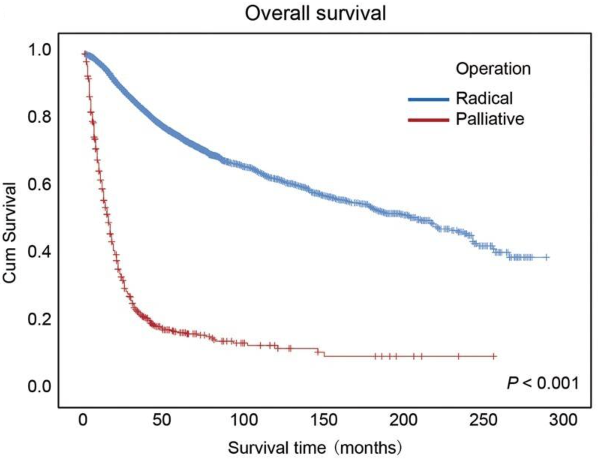

# Accumulation {#sec-accumulation}



```{r include=FALSE}
#| label: ch15-r-cd6c7d55
source("_start-up.R")
# source("R/core-modeling-profiles.R")
source("_software/slope_rose.R")
```

::: {.aside}
`r paste(readLines("_Words/chap_15.txt"), collapse = "\n")` 
:::

Here are a couple of definitions of "accumulation" from the [Oxford Languages]() dictionary.


> *The acquisition or gradual gathering of something. Example: "the accumulation of wealth"*
>
> *A mass or quantity of something that has gradually gathered or been acquired. Example: "the accumulation of paperwork on her desk"*

The previous chapter focused on turning a function into another function that gives the instantaneous rate of change. That process is called *differentiation*. This chapter is about going the other way: starting out with a function that is the derivative of something, and figuring out what that something is. Consider these scenarios:

1. A beachcomber starts with an empty basket and walks north along a beach. Roughly once every five minutes, she sees a collectible shell. She picks it up, places the shell in her basket, and walks on. At the end of a long, two-hour excursion, how many shells has she accumulated?

2. An intern works at a large accounting firm during rush season. He gets paid $25/hour, increasing to $37.50 if he works "overtime," that is, more than 40 hours in a week. At the end of the week, he has worked 68 hours. What are his accumulated earnings for the week?

3. An epidemic spreads through a community. On the first day, only a couple of people catch the virus. But as more people become infected, the infection rate increases, reaching 20 new cases on the 7th day. The health department keeps a daily list of new cases. Overall, how many total cases accumulate during the first seven days?

Each scenario involves a quantity accumulating over time: shells, money, and people falling ill. And each involves one or more *rates of change* and a *duration*

1. One shell per 5 minutes over a two-hour walk. This is equivalent to 12 shells per hour.
2. $25 per hour, going up to the "time-and-a-half" rate of $37.50 per hour after 40 hours worked over 68 total hours.
3. Two new cases per day, increasing to a rate of 20 new cases per day at the end of the first seven days.

Solving the *shell-collection* problem is straightforward: *Multiply the rate times the duration*:

$$\frac{1}{5} \frac{\text{shell}}{\text{minute}} \times 2\, \text {hours} = 
\frac{2}{5}\, \text{shell} \times \frac{\text{hour}}{\text{minute}} = \frac{2}{5} \text{shell} \times \frac{60\ \text{minute}}{\text{minute}} = \frac{120}{5} \text{shell} = 24\, \text{shell}$$

The wages problem involves more bookkeeping. The first 40 working hours are paid at a rate of $25/hour. Multiply the rate times the duration, $$40, \text{hours} \times \$25/\text{hour} = \$1000\ ,$$ giving $1000 for that part of the week. The remaining 68 - 40 = 28 hours are paid at $37.50/hour: $$28, \text{hours} \times \$37.50 / \text{hour} = \$1050 .$$
Adding these two components gives  $1000 + $1050 = $2050 in overall earnings for the week.

The epidemic problem is more difficult because the infection rate (new cases per day) is changing during the week under consideration. This change in rate is also seen in the wages problem, where the wage rate changed from $25 to $37.50 during the period of interest.

Even though the three problems appear to differ in complexity, they can all be solved by the same mathematical method. We call this method "accumulation," but it is more widely known by the standard mathematical term "integration".

\newpage

## The rate-of-change framework

To understand why the three problems posed above can be solved by a single method, let's restate them in a common framework. For each, we'll depict the instantaneous rate of change (with respect to time) as a function of time. The output of the three functions is variously shells/hour, dollars/hour, and cases/day. The left column in @fig-three-problems-roc shows the three rate-of-change functions.

```{r}
#| label: fig-three-problems-roc
#| warning: false
#| layout-ncol: 2
#| echo: false
#| fig-cap: The rate of change function for each of the three scenarios.
#| fig-cap-location: "top"
#| fig-subcap:
#| - Shell collection rate
#| - Shells collected so far
#| - Wage rate
#| - Wages earned so far
#| - New cases rate
#| - Total cases to date
f1 <- function(t) {
  ifelse(t < 0 | t > 2, 0, 12) 
}

f2 <- function(t) {
  ifelse(t < 40, 25, 37.50)
}
f3 <- function(t) {
  2 + 18*t/7
}

F1 <- antiD(f1(t) ~ t)
F2 <- antiD(f2(t) ~ t)
F3 <- antiD(f3(t) ~ t)

slice_plot(f1(t) ~ t, domain(t = -0.5:2.5), npts=1000, color = .slice_color.) |>
  gf_labs(x = "Hours into walk", y = "Shells collection rate (shells per hour)") |> 
  
  gf_lims(y = c(0, 12))

slice_plot(F1(t) ~ t, domain(t = -0.5:2.5), npts=1000, color = .slice_color.) |>
  gf_labs(x = "Hours into walk", y = "Shells") |> 
  
  gf_lims(y = c(0, NA))

slice_plot(f2(h) ~ h, domain(h = -10:110), npts=1000, color = .slice_color.) |>
  gf_vline(xintercept = c(40), color = "white", linewidth = 1.5) |>
  gf_labs(x = "Hours worked", y = "Wage rate ($/hr)") |>
  
  gf_lims(y = c(0,40))

slice_plot(F2(h) ~ h, domain(h = -10:110), npts=1000, color = .slice_color.) |>
  gf_labs(x = "Hours worked", y = "Wages ($)") |>
  
  gf_lims(y = c(0,NA))

slice_plot(f3(d) ~ d, domain(d = 0:7), color = .slice_color.) |>
  gf_labs(x = "Days into epidemic", y = "New cases per day") |>
  
  gf_lims(y = c(0,25))

slice_plot(F3(d) ~ d, domain(d = 0:7), color = .slice_color.) |>
  gf_labs(x = "Days into epidemic", y = "Total cases to date") |>
  
  gf_lims(y = c(0,NA))
```

The right-hand column of @fig-three-problems-roc shows accumulations of the rate-of-change functions in the left column. The left-hand column is where modeling creativity and judgment come into play. Translation to the corresponding functions in the right-hand column is a matter of applying the general accumulation algorithm to each case: a process that is mechanical.


## Example: Figuring taxes owed

`r xf("sec-on-the-margins")` discussed the calculation of income taxes *on the margin*. The tax law specified the *marginal* tax rate at each level of income. (See `r xf("tbl-1913-brackets")`.)

As discussed in `r xf("sec-rates-of-change")`, *differentiation* is the name given to finding a marginal function from a "mother" function. The function so derived is called a *derivative*. These names point to a critically important habit of mind for quantitative reasoners: we think about relationships such as `r xf("tbl-1913-brackets")` as *functions*. Why is this important? Knowing that the relationship is a function reminds us of a set of operations that can be performed on it to put it in a more useful form for whatever purpose is at hand.

Consider the purpose originally served by the tax-bracket table: to inform members of Congress the exact policy they were imposing on taxpayers. The marginal tax-rate format serves this purpose well. But that format is harder for taxpayers to use to calculate how much tax they need to pay. The strange-looking form in `r xf("fig-1913-1040")` Makes clear the difficulty of using the marginal tax-rate format for determining total tax owed.

<!--[Possibly, the legislators did not completely understand their own policy, not envisioning the sort of calculation illustrated in `r xf("fig-1913-1040")`. Senator Elihu Root wrote to a correspondent: "I guess you will have to go to jail. If that is the result of not understanding the Income Tax law I shall meet you there. We will have a merry, merry time, for all our friends will be there. It will be an intellectual center, for no one understands the Income Tax law except persons who have not sufficient intelligence to understand the questions that arise under it." [Source](https://www.taxnotes.com/tax-history-project/tax-history-original-intent-and-revenue-act-1913/2013/09/30/f7h8)]{.column-margin} -->


Quantitative reasoners who know about differentiation and derivatives have a powerful framework for simplifying the presentation of marginal tax-rate information to taxpayers. Since the *marginal* tax rate is a function, we can graph it. (@fig-tax-rate-marginal)

```{r}
#| label: fig-tax-rate-marginal
#| echo: false
#| fig-cap: "Marginal tax-rate as a function of income. This is merely a graphical version of `r xf(\"tbl-1913-brackets\")`. Remember, these are the marginal rates in 1913, not today!"
#| fig-cap-location: top

#| - "Total rate"
T1913 <- tibble::tribble(
  ~ income, ~ rate, ~ cumulative,
  0, 0, 0,
  3000, 1, 0,
  20000, 2, 170,
  50000, 3, 770,
  75000, 4, 1520,
  100000, 5, 2520,
  250000, 6, 10020,
  500000, 7, 25020,
  1000000, 7, 60020
) |>
  mutate(cum_rate = ifelse(cumulative > 0, 100*cumulative/income, 0))

margfun <- 
  function(income) {
    ifelse(income < 3000, 0,
           ifelse(income < 20000, 0.01,
                  ifelse(income < 50000, 0.02,
                         ifelse(income < 75000, 0.03,
                                ifelse(income < 100000, 0.04,
                                       ifelse(income < 250000, 0.05,
                                              ifelse(income < 500000, 0.06, 0.07)))))))
  }
                                                
slice_plot(margfun(income) ~ income, domain(income = 0:1e6), 
           npts=1000, color = .slice_color.) |>
  gf_labs(x = "Income ($)", y = "Marginal Rate") |>
  gf_vline(xintercept = 200000, color = "blue") 

```

The marginal tax rate is the rate that applies to the next dollar of income *at whatever the current income is*. However, it's awkward to use the margin rate for the purpose of computing the total tax owed at the current income level. A simple operation solves the problem, *accumulate* the marginal rate as a function of income. The resulting, accumulated function, plotted in @fig-tax-rate-total, provides a simple function look-up to find the total tax owed for any income.


```{r}
#| label: fig-tax-rate-total
#| echo: false
#| fig-cap: "Total tax owed as a function of income. This is the accumulated form of the marginal tax rate function."
totalfun <- antiD(margfun(income) ~ income)
slice_plot(totalfun(C=0, income) ~ income, 
           domain(income = 0:1e6), npts=1000,
           color = .slice_color.) |>
  gf_labs(x = "Income ($)", y = "Total Tax Owed ($)") |>
  gf_vline(xintercept = 200000, color = "blue")
```

The two functions in @fig-tax-rate-marginal and @fig-tax-rate-total convey the same information, but in different forms. With the *marginal rate* function (@fig-tax-rate-marginal), you can look up the *marginal* tax rate at any income. For example, a blue vertical line has been drawn at an income of $200,000. The marginal tax rate at that income is exactly 5%. 

The *total tax owed* function (@fig-tax-rate-total) is set up to suit people calculating how much to pay. The output is the amount of tax owed. At the blue line for a $200,000 income, the tax owed is $7520. Notice that a total tax calculation using the 5% marginal rate on its own would give a different amount owed: $200,000 $\times$ 5% = $10,000. 

This is not a book about income tax calculations. But marginal rates appear in myriad contexts where our primary interest is in the total. For instance, in all the dynamics examples in `r xf("sec-dynamics")` the dynamical rule tells the marginal change of state. To calculate the state itself, starting from some initial state we *accumulate* the marginal state. The important point is about the connection between the two functions shown in @fig-tax-rate-marginal and @fig-tax-rate-total. This sort of connection is fundamental to quantitative reasoning. The accounting process for accumulation is the same in any context. We need just one method to handle many different settings, not a special method for taxes or for epidemics or for swinging pendulums.

The idea of accumulating a function first emerged in the 1600s in the context of motion. Knowing the force on an object, e.g. the constant gravitational force acting on it, allows one to find the acceleration simply by dividing by the object's mass. [Remember, Newton's Second Law of motion says that force equals mass time acceleration, so acceleration equals force divided by mass.]{.column-margin} Accumulating *acceleration* over time gives the function for velocity versus time. Accumulating velocity gives the function for the object's position versus time. The same accounting process, accumulation, is used *twice* in succession. Velocity and acceleration are related as mother and daughter; acceleration is the derivative of velocity. Similarly, velocity is the derivative of position. 

Many mathematics textbooks use the word `r xf_definition("integration")` to refer to the accounting process that undoes differentiation, for example turning acceleration into velocity in one context or transforming marginal tax rates into total tax rates in another. A more telling mathematical word for this process is `r xf_definition("anti-differentiation")`, which makes explicit the point of the operation: undo differentiation. 

`r xf_definition("Accumulation")` provides a simple, everyday word for the process. You accumulate the marginal tax rate by starting with the first dollar of income. Apply the marginal rate for that $1 income level and place the result into a basket. Now move on to the second dollar of income. Apply the marginal rate for the income level $2 to that second income dollar and add that to the basket. Keep on going. By the time you get to the two-hundred thousandth dollar of income, the marginal rate is 5% and so for that last dollar you would toss 5 cents into the basket. That last toss---the last of 200,000 such tosses---brings the accumulated amount to $7520.

Traditionally, calculus students are taught to use algebra to carry out anti-differentiation, at least for functions that are expressed algebraically. They start by memorizing the anti-derivative of a small set of functions, many of which are in our core modeling function collection. Before computers, such algebraic techniques were often used. In practice, however, only a small cadre of skilled mathematicians used the algebraic techniques. These skilled people wrote books consisting of a long list of functions alongside their anti-derivatives. Such book are called "tables of integration." These days, however, computers store the tables and make it easy to look up the anti-derivatives of algebraically-expressed functions. Continuing to emphasize algebra in teaching is analogous to teaching long division in arithmetic. It is a tedious, error-prone process that is hard to master manually. In practice, however, we use calculators or computers for long division.

Much more important than an algebraic process is developing a modeling understanding of what quantities are related by differentiation and anti-differentiation, for instance total tax and marginal tax rates, or position and velocity.

## Anti-differentiation, graphically

For demonstration purposes, to see how an anti-derivative can be calculated even by a child, let's break convention and use a special graphical format to display a rate-of-change function. 

Keep in mind that differentiation constructs an new "daughter" function from a "mother" function. Finding the daughter is straightforward; it is the function whose **value** at any input corresponds to the **slope** of the mother at that same input. @fig-segmentize shows a function F(x) in blue, annotated with a red compass for measuring slopes. The slope of F() varies across the input values. We can calculate that slope for many different input values. Ordinarily we would plot the derivative---that is, the daughter function---using the vertical axis for the measured slope. 

But @fig-segmentize(a) shows the daughter function not in the usual way as values, but instead as small, sloped line segments in alternating [purple]{style="color: #CC79A7;"} and [blue]{style="color: #0072B2;"}. The reader can confirm this by matching each colored segment to the slope of the smooth function directly above or below it.

```{r}
#| label: fig-segmentize
#| fig-cap: "A function (continuous curve) with its rate-of-change function depicted as short inclined segments." 
#| fig-cap-location: bottom
#| fig-subcap: 
#| - "Differentiation gives the slope for any input."
#| - "Anti-differentiation accumulates the segments to reconstruct the function (green)."
#| echo: false
#| warning: false
#| layout-ncol: 1
f <- doodle_fun(~ x, seed = 133)
Pts <- Znotes::segmentize(f(x) ~ x, h=0.25, domain(x=-5:5), npts=1) |>
  dplyr::mutate(top = cumsum(ymax - ymin), bottom=top - (ymax-ymin))

Pts$alpha <- rep(c(1, 0.3), length.out = nrow(Pts))
Pts$segcolor <- rep(c(.slice_contrast., .slice_color.), length.out = nrow(Pts))

slice_plot(f(x) ~ x, domain(x=-5:5), color = .slice_color.) |>
  gf_segment(ymin + ymax ~ xmin + xmax, data = Pts, color= ~ segcolor, size=1.5) |>
  # gf_segment(bottom + top ~ xmin + xmax, data = Pts) |>
  gf_lims(y=c(-4,10)) |>
  # gf_errorbar(0 ~ -2.35 + -1.85, color="blue", width=2) |>
  # gf_text(0 ~ -2.25, label="dx", color="blue", vjust=-1) |>
  gf_labs(y="Output of F(x)") |>
  add_slope_rose(nice_slopes = c(-2.5, -2, -1.5, -1, -0.5, 0, 0.5, 1, 1.5, 2, 2.5), y = 2.5, x = 0) |>
  gf_refine(scale_color_manual(values=c(.slice_contrast., .slice_color.), guide = "none"))

slice_plot(f(x) ~ x, domain(x=-5:5), alpha = 0, color = .slice_color.) |>
  gf_segment(bottom + top ~ xmin + xmax, data = Pts, color = ~ segcolor, size = 1.5) |>
  gf_segment(ymin + ymax ~ xmin + xmax, data = Pts, color= ~ segcolor, size=1.5) |>
  gf_lims(y=c(-4,10)) |>
  # gf_errorbar(0 ~ -2.35 + -1.85, color="blue", width=2) |>
  # gf_text(0 ~ -2.25, label="dx", color="blue", vjust=-1) |>
  gf_labs(y="Output of F(x)") |>
  add_slope_rose(nice_slopes = c(-2.5, -2, -1.5, -1, -0.5, 0,  0.5, 1, 1.5, 2, 2.5), y = 2.5, x = 0) |>
  gf_refine(scale_color_manual(values=c(.slice_contrast., .slice_color.), guide = "none"))
```

Anti-differentiation is the process of accumulating the sloped segments to reconstruct a function with those slopes. The accumulation itself is child's play. Leave the leftmost segment in place. [Actually, you can move the segment up or down to any level you like. (See the next marginal note.)]{.column-margin} Now move right to the next segment. Raise or lower that until the two segments connect: the right end of the leftmost segment touching the left end of the segment next to it. Continue the process by moving to the next segment, and so on.

Playing this child's game of connecting the segments by moving each segment vertically traces out the green curve. Evidently, the green curve has the same **shape** as the original mother function F(). 

The green curve runs parallel to the original F() but can have a different vertical position. [This is where the freedom to move the first segment to any desired vertical position comes in.]{.callout-note} Why? The game-playing child is free to place the first segment at any vertical position she likes. The reconstructed function will be moved up or down accordingly. When we accumulate, whether seashells or inclined segments, we are free to specify how much was "in the basket" when we started.


## Example: QALYs versus cost

`r xf("fig-QALY-vs-cost")` showed functions for the number of quality-adjusted life-years saved and the expenditure on each of two hypothetical programs, which we called Natal and Cancer. Where did these functions come from? The quick answer is that the functions are the anti-derivatives of another function. That other function, the derivative of QALYs(expenditure), has a simple logic that can easily be illustrated. Such a situation is common across many areas of science or quantitative reasoning. Indeed, we saw it in `r xf("sec-dynamics")`. The SIR model is merely a description of the rates of change of susceptibles and infectives as functions of the numbers in each group. Tracking the course of the epidemic over time was a mechanical operation ("Euler's method") that integrated the rate-of-change functions. 

Consider now the QALY(expenditure) function for the Cancer program. From ongoing public health data collection, we know the `r xf_definition("incidence")` of cancer cases, that is, how many new cases arise in a year. We also have a good idea, from medical experience, of *survival times* for people with cancer and how survival is different with and without treatment. To illustrate, @fig-colon-survival shows "survival curves" for colon cancer victims, comparing those who underwent radical surgery to those where the surgical intervention was merely palliative.

::: {#fig-colon-survival} 



Comparative survival curves for people undergoing surgery for colon cancer. [Source](https://pmc.ncbi.nlm.nih.gov/articles/PMC8677537/figure/goab048-F1/)

:::

`r qr_margin_note(
  "https://pmc.ncbi.nlm.nih.gov/articles/PMC8677537/figure/goab048-F1/",
  paste("Source for", xf("fig-colon-survival"))
)` 

@fig-colon-survival shows two survival "curves" constructed from patients' records in a clinical study. Each curve models the fraction of patients who survive any given number of months after diagnosis. For instance, about 60% of patients who underwent radical surgery survived for 100 months after diagnosis, whereas only about 15% of palliative-treatment patients survived that long.

`r qr_margin_note(
  "https://www3.mdanderson.org/app/medcalc/index.cfm?pagename=coloncancer",
  "Colon-cancer calculator"
)`

The advantage of thinking of survival time as a function is that we can imagine what other inputs might go into the function. For instance, we might have patient age, sex, and stage of cancer at the time of diagnosis, or other information. Such functions are often constructed by researchers. An example, for colon cancer, is linked to in @fig-mdanderson-calculator.

::: {#fig-mdanderson-calculator}


A calculator for (average) survival time with colon cancer. [Link](https://www3.mdanderson.org/app/medcalc/index.cfm?pagename=coloncancer).
:::


Using such functions, we can compute the expected survival time for each age or cancer-stage class of patients diagnosed with colon cancer. More specifically, we can compute the average *extra* survival time for those who undergo radical surgery.

[This illustrates an important distinction between public health and medicine. For an individual patient, a medical doctor might prefer to present the survival curve to show the range of possible outcomes. But for social policy making, we are not dealing with individuals but *groups* of people. This is the public health perspective. Average outcome gives a good indication for the group as a whole.]{.column-margin}

For the sake of argument, we will imagine that the average *extra* survival time is a decreasing function of age. That is, younger patients are more likely to survive longer. Perhaps this is more easily seen in reverse. An elderly patient is, for various reasons, unlikely to survive the 20-year period covered by the survival curve. @fig-survival-sketch sketches out what the *extra* survival time verus age function might look like. 

```{r}
#| label: fig-survival-sketch
#| echo: false
#| fig-cap: "A sketch of an imagined function giving *extra* survival time versus age."
survive <- function(age) {
  10 * hillside(-(age-60)/12)
}
slice_plot(survive(age) ~ age, domain(age = 30:80), color = .slice_color.) |>
  gf_labs(y = "Years of survival", x = "Age at diagnosis") |>
  gf_lims(y = c(0,10)) |>
  gf_theme(theme_minimal(base_size = 16))

```

A detailed calculation is needed to translate @fig-survival-sketch into a function of QALYs saved per person treated. The calculation is hard to understand without extensive modeling experience, but the general outline is accessible. Using only the treatment cost and the age distribution of incidence, we can translate the horizontal axis into the total cost of treating all people up to any given age. The result will be a graph showing the marginal QALYs saved at each cost. Accumulating (anti-differentiating) that marginal QALYs saved function over the cost produces the curve shown in `r xf("fig-QALY-vs-cost")`(b). 

The point for us is that figuring out relationships like that in `r xf("fig-QALY-vs-cost")`(b) is based on several habits of experienced quantitative reasoners:

1. Thinking of QALYs saved *on the margin*, that is, the function that describes how many additional QALYs are saved for each additional unit of cost.

2. Knowing that the on-the-margin function corresponds to another function, total QALYs saved versus cost, that is, an ordinary anti-derivative of the function in (1). 

3. Realizing that the function in (1) is much easier to justify in an argument. Consequently, it is a good format for modeling the relationship between QALYs saved and cost. Then, the automated process of anti-differentiation, not modeling judgment, will produce the function in (2). Knowing that we are free to model with (1) but automatically reframe the result as (2) makes the process easier.


## Example: Predicting peak population {#sec-peak-population}

Sometimes, clear patterns in the rate-of-change function can be easily modeled, but then need to be translated via anti-differentiation to display the information of interest. An instance of this is seen in the population of the US, as it has grown over the centuries.

Every 10 years, starting in 1790, the US Census Bureau carries out a constitutionally mandated census: a count of the current population. The overall count as a function of year is shown in @fig-population-vs-year. 

```{r}
#| label: get-us-pop
#| echo: false
#| message: false
#| warning: false
USPop <- readr::read_csv("www/census-totals.csv")
Tmp <- USPop |> 
  mutate(population=prettyNum(population, big.mark=",")) |>
  select(-growth_rate)
USPop <- USPop |> 
  mutate(population = population/1e6)
Table <- if (knitr::is_html_output()) {
  DT::datatable(Tmp) |>
    DT::formatStyle("population", textAlign = "right")
} else {
  knitr::kable(Tmp, align = c("r", "r"))
}
```

`r qr_margin_note(
  "https://en.wikipedia.org/wiki/Demographic_history_of_the_United_States",
  paste("Data source for", xf("fig-population-vs-year"))
)`

In the 230 years spanned by the census data, the US population has grown 100-fold, from about 4 million in 1790 to about 330,000,000 in 2020. @fig-population-vs-year shows the growth as a steadily climbing function output over time.. 


```{r echo=FALSE, warning=FALSE} 
popfun <- spliner(population ~ year, data = USPop)
USPop <- USPop |>
  mutate(growth = population - lag(population)) |>
  mutate(ygrowth = growth/10) |>  # yearly growth
  mutate(prop_growth = ygrowth/population) |>
  mutate(yearly_growth_rate = 100*((1+growth_rate/100)^(1/10) - 1)) |>
  mutate(theory = 0.0194 * population) |>
  mutate(exp_pattern = 3.93*1.0194^(year - 1790)) |>
  mutate(exp_pattern2 = 3.93*1.031^(year - 1790))
mod <- lm(population ~ poly(year, 2), data = USPop)
modf <- makeFun(mod)
P1 <-gf_point(population ~ year, data = USPop) |>
  gf_line(population ~ year) |>
  gf_labs(y="Population (millions)", x = "Year") |>
  gf_line(exp_pattern ~ year, color = "blue", alpha = 0.5) |>
  gf_line(exp_pattern2 ~ year, color = "tomato", alpha = 0.5) |>
  gf_text(400 ~ 1940, label = "3.1%", color = "tomato", alpha = 0.5, inherit = FALSE) |>
  gf_text(350 ~ 2020, label = "1.94%", color = "blue", alpha = 0.5, inherit = FALSE) |>
  gf_lims(x = c(1790, 2100), y=c(0,500))
# P2 <- gf_point(population ~ year, data = USPop) |>
#   gf_point(500 ~ 2100, alpha=0) |>
#   gf_line(population ~ year) |>
#   gf_labs(y="Population (millions)", x = "Year") |>
#   gf_refine(scale_y_log10(breaks=100*(0:5))) |>
#   gf_lims(x = c(1790, 2100))
P2 <- gf_point(ygrowth ~ year, data = USPop) |>
  gf_line(ygrowth ~ year, color = .slope_color.) |>
  gf_lm(ygrowth ~ year, color = .slice_contrast.) |>
  gf_labs(y="Yearly population growth (millions)", x = "Year") |>
  gf_lims(x = c(1790, 2100), y=c(0,3.5)) |>
  gf_vline(xintercept = c(1870, 1940, 1960, 2000), color = .vline_color.)

mod <- lm(yearly_growth_rate ~ year, data = USPop)
P3 <- gf_point(ygrowth ~ population, data = USPop) |>
  gf_line(ygrowth ~ population) |>
  # gf_abline( intercept = 0, slope = coef(mod), color = "blue") |>
  gf_line(theory ~ population, color = .slice_color.) |>
  gf_labs(y="Rate of change of population (millions/year)", x = "Population (millions)") |>
  gf_lims(x = c(0,500), y=c(0,3.5))
P4 <- gf_point(yearly_growth_rate ~ year, data = USPop) |>
  gf_line(yearly_growth_rate ~ year) |>
  gf_lm(yearly_growth_rate ~ year, color = .slice_contrast.) |>
  gf_labs(y="Per capita growth rate (percent/year)", x = "Year") |>
  gf_lims(x = c(1790, 2100), y=c(0,3.5))
```

```{r}
#| label: fig-population-vs-year 
#| echo: false
#| warning: false
#| message: false
#| fig-cap: "The US population since the first census in 1790. The annotations show what exponential growth at different rates would look like."
#| fig-cap-location: top
P1 
```

The growth *appears* smooth in @fig-population-vs-year. Perhaps it is reminiscent of exponential growth. It turns out that this is not the case. The exponential annotations in @fig-population-vs-year are clearly different from the actual data.

We can get a better look at the population growth if, rather than inferring it from the *slope* of the graph in @fig-population-vs-year, we look at the *rate of change directly* as the quantity on the vertical axis. The units of the rate of change are millions of people per year, that is, the yearly increment in the population. This is shown in @fig-pop-ROC.

```{r}
#| label: fig-pop-ROC
#| echo: false
#| warning: false
#| message: false
#| fig-cap: "Rate of change of US population. The units are millions of people per year. Vertical lines mark the historical events mentioned in the text: Civil War, Depression, Baby Boom, Immigration reform. The sloping [reddish trend line]{style='color: \"#D55E00;\"'} shows a long term trend."
P2 
```

The overall pattern is that yearly population increase has grown over the 210 years since the first census. Currently, the growth rate is about 2.5 million people per year, but during the interval from 1790 to 1800, population growth was much smaller: 0.14 million per year.That shouldn't be surprising, since a larger population tends to add more people each year.

The data show fluctuations---ups and downs deviating from the overall straight-line trend. These are not just random. The deviations correspond to historical events. The decade 1860-1870, due to the US Civil War, growth rate was relatively low. The Great Depression is evident in the very low growth rates from 1930 to 1940. Baby Boom: look at the growth from 1950 to 1960. The bump from 1990 to 2000? Not coincidentally, the 1990 Immigration Act substantially increased the yearly rate of immigration.

The rate of change in population (with respect to time) is the slope of the segments in @fig-population-vs-year. In contrast, @fig-pop-ROC translates that slope into position along the vertical axis. The [reddish trend line]{style="color: \"#D55E00;\""} guides the eye to see an ascending, straight-line pattern in the data. This trend line makes it easier to see the deviations from the trend in the data. 

One is tempted to conclude from @fig-population-vs-year that, if the US population follows the historical pattern, it will continue to grow at an ever-faster rate of around 2.5 million people per year. At that rate, the US population would grow to about 500 million by the end of the century. However, that conclusion is not well-founded. The problem is the lack of a theoretical framework for interpreting the data.

`r xf("sec-dynamics")` has some lessons to teach about growth, particularly exponential growth. Remember that the Euler framework for dynamics does not start with a time series, such as those in @fig-population-vs-year. Instead, the Euler framework starts with a *dynamical rule*, the function that takes the *state* of the system (population, here) and turns it into a rate of change with respect to time. The plots in @fig-population-vs-year and @fig-pop-ROC have *time* on the horizontal axis, not population.  A dynamical rule, on the other hand, would show the rate of change in population versus *population* itself. @fig-pop-dynamics re-arranges the census data in this way.

```{r}
#| label: fig-pop-dynamics
#| echo: false
#| warning: false
#| fig-cap: "Dynamical rule format for the yearly population growth (millions/year) versus population. The annotation shows the rule *if growth were proportional to population*, persisting at the same rate as in about 1800."
#| fig-cap-location: top
P3 
```

The data in @fig-pop-dynamics suggest that yearly growth is leveling off as population increases. Certainly, the US is a long way from the fast growth seen around 1800.

Wait! Doesn't @fig-pop-dynamics show that when the population was small, as it was around 1800, the yearly growth was also small? Why did we call that "fast growth"?

The small population growth was fast in the sense that the population growth *per capita* per year was high. @fig-pop-dynamics shows total population growth, not per capita. To calculate the per capita rate, we need to divide the yearly growth by the population. We do this in @fig-rate-dynamics where the vertical axis is in percent per year rather than millions of people per year. 

```{r}
#| label: fig-rate-dynamics
#| echo: false
#| warning: false
#| fig-cap: "Per capita yearly growth rate (%) over the years."
P4 
```

We have a choice of how to represent the trends in growth. We could look at per capita growth rate (percent per year) as a function of population. Or, we could plot per capita growth rate (percent per year) as a function of the *year*. The two approaches give similar results, but we prefer to use per capita growth rate as it changes over the years. Why? Because world-wide data shows that in most countries---including small and large countries---per capita growth rate has declined. This model reflects the intuition that changes in the economy and society are effecting growth. For example, contraception is much more available now than in the past. In the US, over the last 50 years the participation of women in the work force has growth. This makes it difficult to manage large families, especially when pre-school day care is so expensive. 

The goal of the model is to support predictions about future population. We can start with the current (as of the 2020 census) population: about 330 million. Then, for 2020, calculate the yearly per capita growth rate using the model in @fig-rate-dynamics. The model gives a rate of 0.65 percent per year. So the predicted 2021 population is $$330 \text{million} \times 1.0065 \approx 332\ \text{million}.$$

For 2021, the model growth rate is slightly less: 0.64 percent per year. So the predicted 2022 population is $332 \times 1.0064 \approx 334$ million. As the years progress, the per capita growth rate steadily declines. By 2075, the model has the growth rate at zero. That's when the population levels out. The growth rate becomes *negative* after 2075; the population starts declining!

@fig-population-future reports the predicted population calculated by accumulating the yearly growth from 2020 onward.

```{r}
#| label: fig-population-future
#| echo: false
#| warning: false
#| fig-cap: "The Census population data along with the function formed by accumulating the rate-of-change function from 2020 onward, using the model in @fig-pop-dynamics."
growth_mod <- lm(yearly_growth_rate ~ year, data = USPop)
growth_fun <- makeFun(growth_mod)
accum <- tibble(year = 2021:2130,
                pop = 331 * cumprod(1 + growth_fun(2021:2130)/100))

gf_point(population ~ year, data = USPop) |>
  gf_labs(y="Population (millions)") |>
  gf_lims(x = c(1790, 2130), y=c(0,450)) |>
  gf_line(pop ~ year, data = accum, color="magenta") |>
  gf_point(404.4 ~ 2060, color="dodgerblue", size=1) 
```


According to the accumulation model, the population peaks in 2075 at 390 million. We will be back down to the present population level in about 100 years. 

Professional demographers construct much more sophisticated models using detailed data from many sources and, as needed, take into account the age structure of the population to predict future births. The demographers at the US Census Bureau predict that the population will reach a maximum of 404 million in 2060, shown by the little blue dot in @fig-population-future. That is not too different from what we got by analyzing the raw census numbers alone. Importantly, we analyzed those numbers in the context of the Euler framework (`r xf("sec-dynamics")`), formulating a model dynamical rule and using the *accounting method* (that is, *accumulation*) to translate the dynamical rule into a time series.

