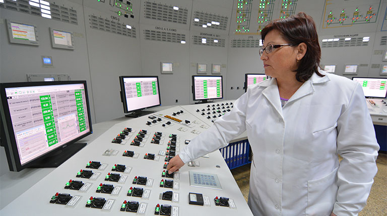
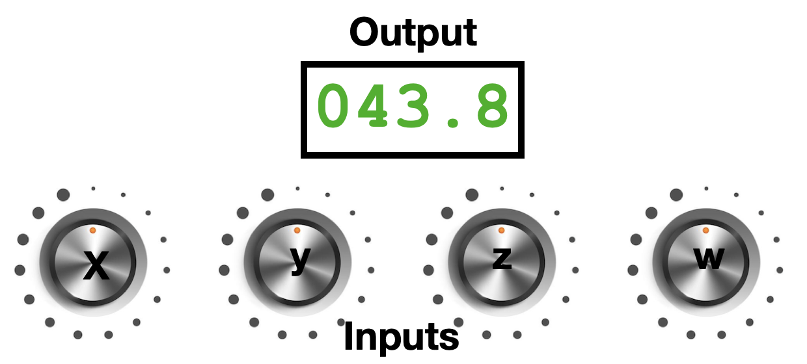
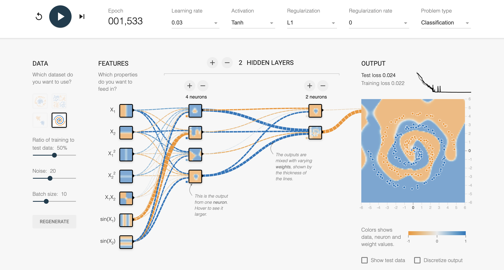
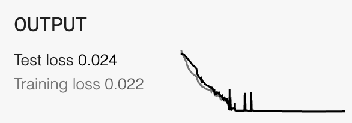
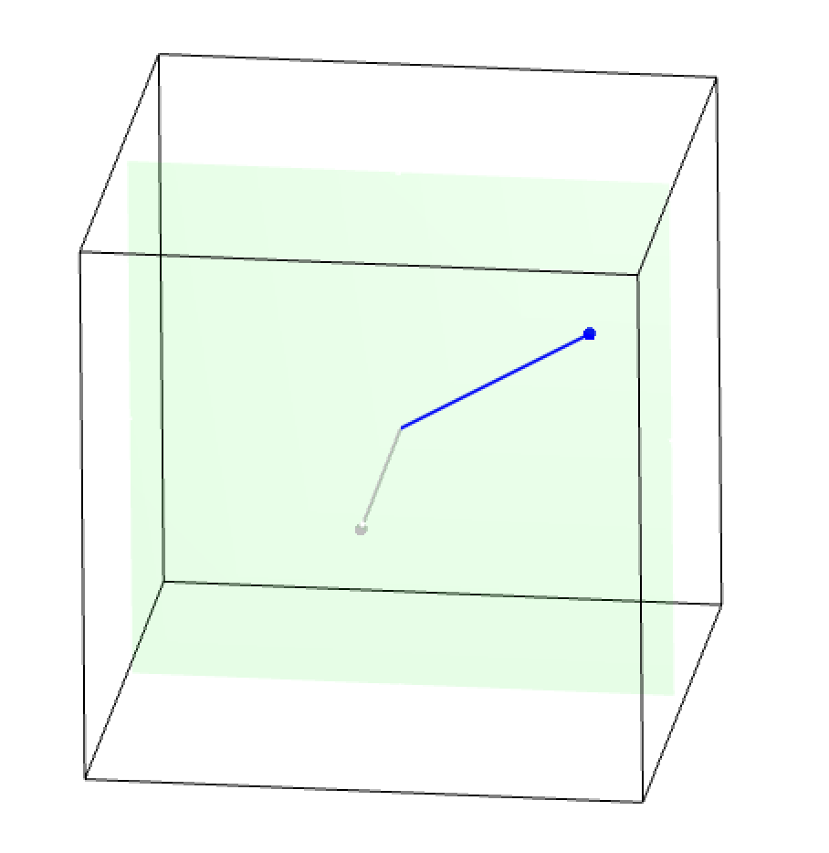
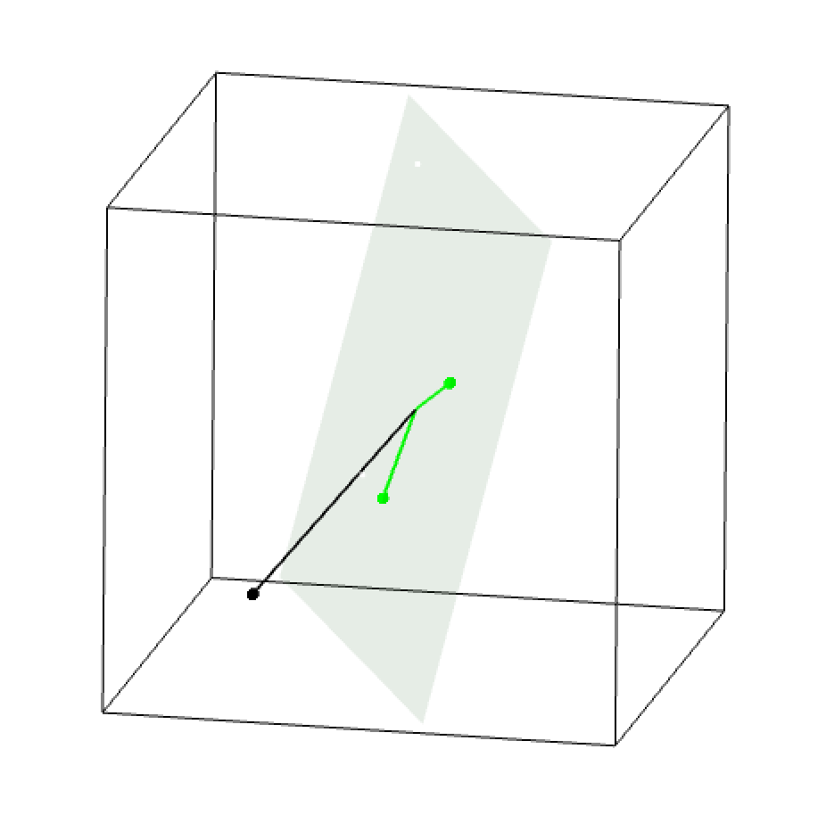
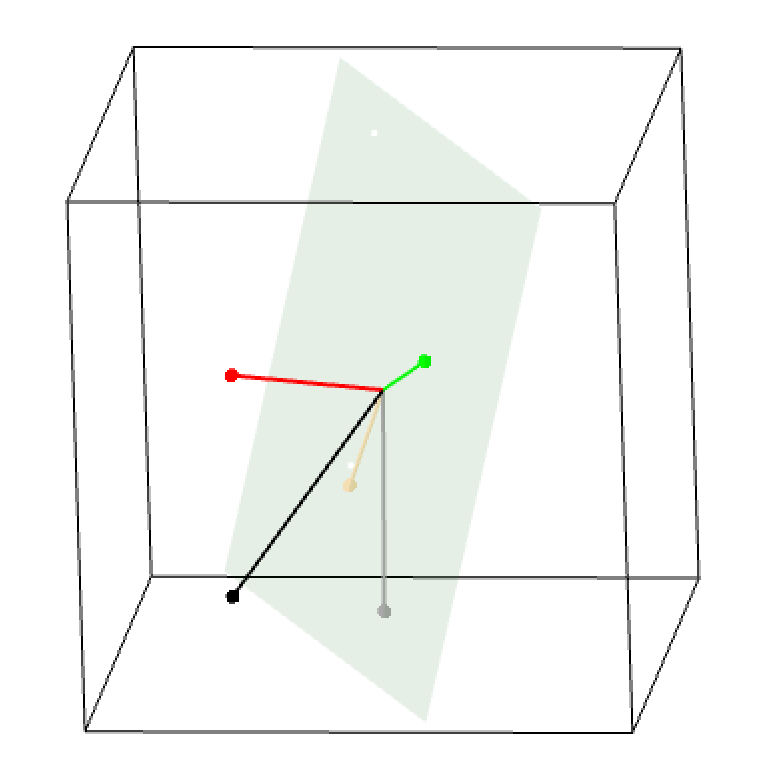
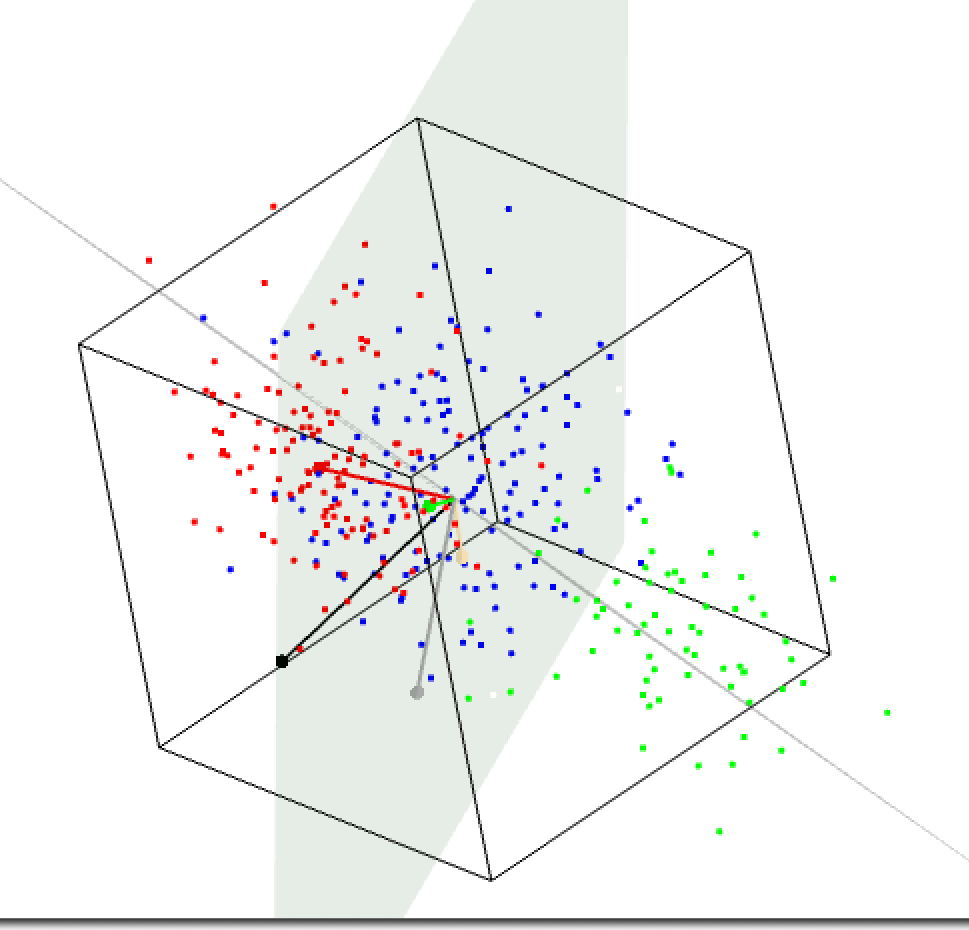
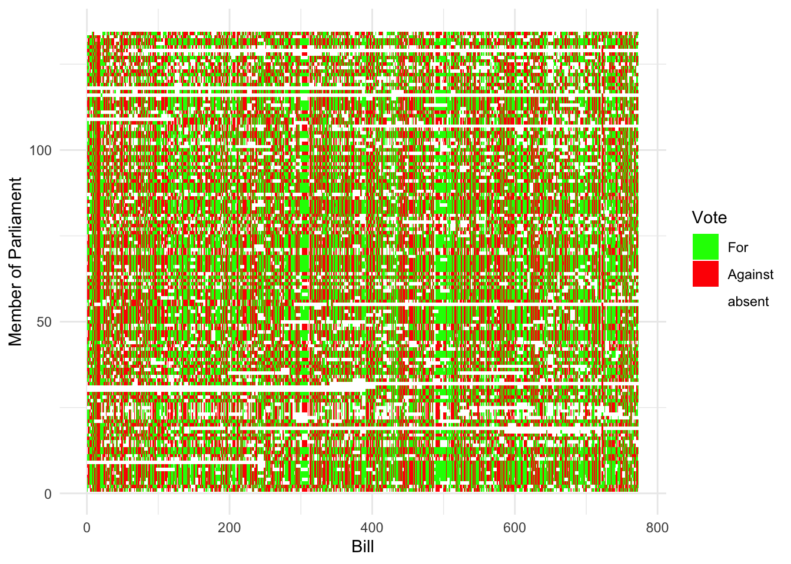

# Moving Past Two Inputs {#sec-moving-past-two-inputs} 




```{r include=FALSE}
#| label: ch16-r-de4e425b
source("_start-up.R")
library(rgl)
setupKnitr(autoprint = TRUE) 
# knitr::knit_hooks$set(webgl = hook_webgl)
# This is recommended by the documentation for automatic rendering:
```

::: {.aside}
`r paste(readLines("_Words/chap_16.txt"), collapse = "\n")` 
:::

Previous chapters introduced a framework for quantitative thinking, highlighting dimensionality, which relates aspects of the world through mathematical relationships, such as between location and velocity or between energy and power.

* Functions and their input spaces describe how different aspects of the world are related. They also provide a way to express uncertainty and likelihood, and to extract information from data in a Bayesian style.
* Magnitudes as a device for relating the very large to the very small;
* Rates of change and accumulation are versatile tools. They represent dynamics, guide decisions, and capture common relationships among aspects of the world.

This framework developed over centuries, spurred by ingenuity, insight, and technological advances such as computing.

In this final chapter, we bring together these components to show how the framework enables new forms of quantitative reasoning. These new approaches take on many forms; for example, the emergence of Large Language Models that attempt to capture meaning in text.


## Revising high-school algebra

To start, we examine two familiar high school algebra problems. Techniques for these were developed when paper and pencil were students' only tools. Unsurprisingly, such methods are ineffective with several variables—and even less so with large quantities.

1. Find "solutions", "x-intercepts," and "roots." These words signal the same kind of problem: finding function inputs that result in a specified output. Here, a "solution" is a value of x that makes the equation true, an "x-intercept" is a point where the graph crosses the x-axis, and a "root" is another term for a solution. For example, you might be asked to find the roots of a polynomial such as $x^2 - 2 x - 3$. This is the same as "solving" $x^2 - 2x - 3 = 0$.


2. Solve `r xf_definition("simultaneous equations")`. There is more than one function, each sharing the same inputs. You want to find the input values that make each function reach a specified value. The classical textbook situation posits that the number of functions equals the number of unknown inputs, but so far as modeling is concerned there can be more flexibility.


$\begin{array}{ccccc}
5\, x & - & 2\,  y & = & 4\\
2\, x & + & 3\, y & = & -2\\
\end{array}$


A third problem setting, `r xf_definition("optimization")`, is important across applications of quantitative reasoning. It is just beyond the reach of high school algebra methods. An example in the style of high-school algebra is: Given that $x \times y = 100$, what values of $x$ and $y$ give the smallest value for $x + y$?[Or, given that the area of a rectangle is 100 in^2^, what should the side lengths be so the perimeter is as short as possible.]{.column-margin}


These three problem settings are important in practice. Imagine yourself controlling a complex system: adjusting valves, pumps, and burners in a chemical plant, or managing logistics to source components for a product like a cell phone. `r xf("fig-control-panel")` shows a generic image of this situation.


::: {#fig-control-panel}
{width="3in"}

A control panel for managing a complex system.
:::

Perhaps your task for the day is adjusting the controls so the tank's temperature and pressure stay at the right levels. You need to adjust dials, flip switches, and so on. Or, in a bigger task, you might have to maximize plant productivity while staying within quality and safety limits.

These tasks fit into a framework for finding solutions or optimizing. You don’t have the system’s "equations," but you have some basic knowledge, outputs from various gauges, and switches and dials to set inputs. Quantitative tools here differ from the symbol manipulation found in high school problems. Let’s examine these tools and how they relate to topics from previous chapters.

## Walking uphill

Every child knows how to get to the top of a hill: walk uphill! In this section, we look at the basic mathematics of walking uphill. We then extend it to the realistic case where the entire scene is hidden by impenetrable fog.

We want to solve quantitative problems by walking uphill (or downhill) to find solutions and optimize. For illustration, we create mathematical hills and explore ways to move in the right direction.

Our mathematical hills will be functions. The function's output is the hill's elevation. The inputs are the latitude and longitude of your location. For simplicity, we start with functions with a single input, as if you were obliged to walk along a road to get to the top of the hill. The function's input is the position along the road.

```{r}
#| label: fig-hill-1
#| echo: false
#| fig-cap: "Elevation vs position along a road"
#| fig-width: 5
#| fig-height: 4
raw <- doodle_fun( ~ x, seed = 8329)                 
f <- function(x) 30 + raw(x-2)
slice_plot(f(distance) ~ distance, domain(distance = 0:10), color = .slice_color.) |>
  gf_labs(x = "Position on road (km)", y = "Elevation (m)") 
```

`r xf("fig-hill-1")` provides an example of such a function. Where should you walk on the road to reach the highest elevation? A glance is enough to find the answer: about 5 km.

`r xf("fig-hill-1")`(b) shows a more realistic view. You can’t see the whole function. You only know the elevation at your current spot and whatever you note in your notebook. We start the walker at position 2 on the road, where the elevation is about 12 m.

```{r}
#| label: fig-hill-2
#| echo: false
#| warning: false
#| fig-cap: "Elevation vs position along a road, displaying the value of the output only at the places where you have already been. Rate of change is the slope of the blue segment."

slice_plot(f(distance) ~ distance, domain(distance = 0:10), alpha = 0, color = .slice_color.) |>
  gf_labs(x = "Distance along road (km)", y = "Elevation (m)") |>
  slice_plot(f(distance) ~ distance, domain(distance=1.75:2.25), alpha = 0.5, color = .slice_contrast.) |>
  gf_point(f(2) ~ 2) 
```

The key tool for navigating the foggy road is the rate-of-change function: the derivative. You can find its value at your position by taking a small step right, then measuring the elevation again. If the new elevation is higher, the rate of change is positive.

The algorithm for reaching the top can be simple: if the function's rate of change is positive, step to the right. Otherwise, go left. Keep on stepping in this fashion.

[The interesting problems are those with many inputs]{style="font-variant:small-caps;"} and expensive evaluations. For example, setting inputs might require shutting down an entire chemical plant. Another example comes from AI: optimizing a large-language model (LLM) like GPT-5 involves about 500 billion inputs. In both cases, finding a good maximum output yields the desired intelligence or outcome.

While building an LLM is far beyond our scope—we would need significant resources for that—we can still develop intuition for strategies that help us find an optimum without graphing the function.

`r qr_margin_note(
  "https://dtkaplan.shinyapps.io/QR-A-shiny/",
  "Interactive web app"
)`

\newpage

::: {.callout-note icon="false"}
## An interactive web app.

A collection of interactive web apps for QR-A is provided at [https://dtkaplan.shinyapps.io/QR-A-shiny/](https://dtkaplan.shinyapps.io/QR-A-shiny/), including one that lets you evaluate a function without graphing it. Go to the Optimization/g(x,y) menu and experiment. It's hard to find the maximum of a function with two inputs without a graph. But if you turn on the "Follow Gradient" feature, you'll always know which direction is up. Take small, successive steps along the arrow; you’ll trace an uphill path. Until you develop intuition, you may get stuck. Use the "training wheels" option when you need help.
::: 


This strategy of walking uphill also applies to functions with 2 or more inputs, including functions with hundreds, thousands, or millions of inputs. With two inputs, we can create a visualization that guides our intuition for dealing with functions with many inputs.

Recall that a function with two inputs, say $f(x, y)$, has two different rate-of-change functions. Imagine standing at your position on the hill. That position is the intersection of two roads. One road runs east-west, the other runs north-south, as in `r xf("fig-hill-with-roads")`.


```{r}
#| label: fig-hill-with-roads
#| echo: false
#| warning: false
#| fig-cap: "A landscape with two roads. You are standing at the red dot."
#| fig-cap-location: bottom
#| layout-ncol: 2
#| fig-subcap: 
#| - "Zoomed out to show a large region"
#| - "Zoomed in close to the intersection of the roads"
g <- doodle_fun( ~ x + y, seed = 8332)
contour_plot(g(longitude, latitude) ~ longitude & latitude,
             domain(longitude = -5:5, latitude = -5:5)) |>
  gf_hline(yintercept = ~ -1.25, color = .hline_color., linewidth = 2) |>
  gf_vline(xintercept = ~ -3.5, color = .vline_color., linewidth = 2) |>
  gf_point(-1.25 ~ -3.5, color = "tomato", size=2, alpha = 0.1, inherit = FALSE) |>
  gf_refine(coord_fixed()) 
# ggsave("fig-hill-with-roads-a.png") # for pdf version

contour_plot(g(longitude, latitude) ~ longitude & latitude,
             domain(longitude = -3.6:-3.4, latitude = -1.15:-1.35),
             skip = 0) |>
  gf_hline(yintercept = ~ -1.25, color = .hline_color., linewidth = 2) |>
  gf_vline(xintercept = ~ -3.5, color = .vline_color., linewidth = 2) |>
  gf_point(-1.25 ~ -3.5, color = "tomato", size=4, alpha = 0.1, inherit = FALSE) |>
  gf_segment(-1.25 + -1.25 ~ -3.5 + -3.475, color = "darkgreen",
             arrow = arrow(length = unit(2, "mm"))) |>
  gf_segment(-1.25 + -1.225 ~ -3.5 + -3.5, color = "darkgreen",
             arrow = arrow(length = unit(2, "mm"))) |>
  gf_refine(coord_fixed())
# ggsave("fig-hill-with-roads-b.png") # for the pdf version
```

To start, you are at elevation 11.98 m. Take a step to the east, that is, right on the gray road. For definiteness, each step will be thelength of the green arrows. The eastward step will take you to an elevation of about 12.06 m, that is, an elevation gain of 0.08 m. In contrast, the step to the north will take you downhill to an elevation of about 11.93 m, a loss of 0.05 m.

From this information, you can calculate the steepest uphill direction. To judge from `r xf("fig-hill-with-roads")`, the steepest step will be in the east-south-east direction.

The step to the east gives you what’s needed to calculate the rate of change of the output with respect to longitude evaluated at the red dot. The step to the north gives you the rate of change of the output with respect to latitude. Each step is a quantity with units of meters (of elevation) per degree (of latitude) for the north step or meters (of elevation) per degree (of longitude) for the east step. Combining the two rates of change gives the direction of steepest ascent on the hill and the amount of elevation gain achieved by taking a unit-length step. This information—direction and amount—is called the `r xf_definition("gradient")`.

The word "gradient" comes from a Latin root gradi, meaning "to step" or "to advance." The gradient is a `r xf_definition("vector")`. The word "vector" stems from the Latin vehere, meaning "to carry." The gradient vector carries you uphill. The algorithm for optimizing by following the gradient vector dates back to 1847.


## Another description of the gradient

The rate-of-change functions give important information about the way uphill. We use the plural "functions" because each direction has its own rate of change function. The goal for the mathematical hill climber: find the direction with the greatest rate of change.

The problem setup is this:

1. You have a function $f(x, y, \ldots)$ for which you seek to find the value for each input that will give the greatest possible output. We will denote these input values as $x^\star, y^\star, \ldots$, but we do not yet know their values.
2. We are standing at a position $(x_0, y_0, \ldots)$. This is our starting position. It is often chosen at random, as if we drifted downward into the terrain like a leaf or raindrop.
3. We want to find a direction that points uphill and, ideally, uphill in the steepest possible direction.
4. Once you find this direction, take a *tiny* step forward to a new position $(x_1, y_1, \ldots)$. The new position will be higher than the previous one, since the gradient always points uphill. Repeat (3) and (4) many times. In `r xf("fig-gradient-climb")`, these successive steps are marked by circles.

```{r}
#| label: fig-gradient-climb
#| fig-cap: "Success steps climbing up the gradient from initial position 0. Each gray arrow is the gradient vector from the current position."
#| echo: false
#| warning: false
g <- doodle_fun( ~ x + y, seed = 8332)
step <- 0.2
show_step <- 0.7
dgdx <- D(g(x, y) ~ x)
dgdy <- D(g(x, y) ~ y)
position <- data.frame(x = 2.5, y = -1, dx = NA, dy = NA)
for (k in 2:10) {
  deltax <- dgdx(position$x[k-1], position$y[k-1])
  deltay <- dgdy(position$x[k-1], position$y[k-1])
  position$dx[k-1] <- deltax
  position$dy[k-1] <- deltay
  newpos <- data.frame(x = position$x[k-1] + step * position$dx[k-1],
                       y = position$y[k-1] + step * position$dy[k-1],
                       dx = NA, dy = NA)
  position <- bind_rows(position, newpos)
}
position$n <- as.character((1:nrow(position))-1)
position <- position |>
  dplyr::mutate(gx = x + show_step * dx, gy = y + show_step * dy)


contour_plot(g(x, y) ~ x & y, domain(x = -5:5, y = -5:5), alpha = 0.5, label_alpha = 0.5) |>
  gf_refine(coord_fixed()) |>
  gf_segment(y + gy ~ x + gx, data = position, arrow = arrow(length = unit(2, "mm")), color = "darkgray" ) |>
  gf_point(y ~ x, inherit=FALSE, data = position, shape = 1, size = 4) |>
  gf_text(y ~ x, inherit = FALSE, data = position, label = ~ n, size = 3, color="tomato") 
```


The walk started at a random position, marked by a circle labeled 0. From position 0, we find the uphill direction. This is the gray arrow from 0. We go a small distance that way and reach position 1. Find the uphill direction again and walk a small distance to point. Continue the process. As we approach the maximum, the steps become shorter. We can stop whenever the steps are too small to matter.

To implement this simple algorithm, we need to find the (steepest) uphill direction. We can do this with purely local information about the rate of change around our current position. A function with two inputs, has two rates of change. We can imagine one rate-of-change refers to north-south movements, the other to east-west movements. These rates of change are easy to calculate:

For the east-west direction, the rate of change is
$$\partial_x f(x_0, y_0) = \frac{f(x_0 + h, y_0) - f(x_0, y_0)}{h} .$$ Similarly, the north-south rate of change is $$\partial_y f(x_0, y_0) = \frac{f(x_0, y_0 + h) - f(x_0, y_0)}{h} .$$
As discussed in `r xf("sec-rates-of-change")`, we can set $h$ to be any small value. The most uphill direction at an input location $(x_0, y_0)$ turns out to be $$\left(\partial_x f(x_0, y_0),\  \partial_y f(x_0, y_0)\right)\ .$${#eq-partial-gradient} This coordinate pair can be interpreted as a direction and length in the $(x, y)$ space. In mathematics, a coordinate pair such as (3, 4) can be interpreted either as a position in Cartesian coordinates or, equally well, as the direction and distance from the point (0, 0) to that position. When we interpret a coordinate pair as a direction/distance, we call the pair a *vector*. 

Vectors serve many important purposes throughout science and technology. The "gradient vector" at the input location $(x_0, y_0)$ is an ordinary vector, which we create by calculating `r xf("eq-partial-gradient")` for the inputs $x_0$ and $y_0$.

The gradient ascent algorithm works with almost any function with any number of inputs. It doesn’t matter if the function is expressed as a formula or as a real-world setting, such as a chemical plant or a logistics operation. The only information needed is local. Following the chemical plant analogy, imagine a set of dials that control the plant, as in `r xf("fig-set-of-dials")`.


::: {#fig-set-of-dials}


Control inputs and a readout of an output.
:::

Each dial's setting specifies one input. All input dials together determine a position in what we might call dial space. The space in `r xf("fig-set-of-dials")` is four-dimensional. For any setting of the dials—that is, any position in dial space—the function produces an output. The readout in `r xf("fig-set-of-dials")` displays this output value.

In `r xf("fig-set-of-dials")`, all the dials are set to 1.

To calculate the rate of change for a dial, record the output displayed: 43.8. Then turn the X dial a small amount, say to 3. This is a change of 2 in the dial position. Suppose, in consequence of the change, that the output now reads 42.2. Then the rate of change is $\frac{42.2 - 43.8}{+2} = -0.8$. This manipulation tells us that $\partial_X f(1, 1, 1, 1) = -0.8$.

Turn the X dial back to its original position. Then repeat the procedure with the Y dial. Suppose the rate of change with respect to Y is $\partial_Y f(1, 1, 1, 1) = 1.3$. Turn Y back to its original position, then again repeat the procedure with Z, and once again with W. Suppose that the manipulation of Z gives $\partial_Z f(1, 1, 1, 1) = -0.9$ and W gives $\partial_W f(1, 1, 1, 1)= 2.2$. You now assemble the gradient vector: 
$$\left(\partial_X f(1, 1, 1, 1),\  \partial_Y f(1, 1, 1, 1),\  \partial_Z  f(1, 1, 1, 1),\  \partial_W f(1, 1, 1, 1)\right) = (-0.8, 1.3, -0.9, 2.2)\ .$$

This four-component vector is a direction in the four-dimensional dial space. The gradient vector accounts for changes in output even when multiple dials are moved. For instance, suppose we turn down X by 0.5, increase Y by 1, increase Z by 0.2, and turn down W by 1. Take this change vector, multiply it by the gradient, and sum to find the overall change to the output from the multiple changes to the dials. 

$$-0.8 \times 0.5 + 1.3 \times 1 + -0.9 \times 0.2 + 2.2 \times -1 = -1.4\ \text{change in output}$$


## Example: Training a neural network

One very widely used function type used in AI and other areas of technology is the "neural network." A neural network is a function; it maps input data to output predictions. It consists of layers of interconnected nodes, or "neurons," each performing a seemingly simple computation to produce a numerical output. 

`r xf("fig-nn-playground")` shows a relatively simple neural network provided for demonstration purposes by the organization <tensorflow.org>.  Since the network is small, <tensorflow.org> can provide an excellent graphical depiction. (The neural networks used in AI are vastly more complex and not well understood even by the people who build them.)

::: {#fig-nn-playground}


A snapshot from a demonstrator web app showing training for a simple neural network model. You can interact with the demonstrator at <https://playground.tensorflow.org/>
:::

The *interactive* demonstration shows the process of building a network to serve a particular purpose. To start, let's work through the structure from left to right in `r xf("fig-nn-playground")`.

The area labeled "Data" on the left represents a data frame. Each row of the data frame records the x-y position of a point, together with a column holding the group to which the point belongs, like this:

X | Y | Group
--|--|--
0.43 |-0.21 | orange  
0.12 | 0.34 | blue  
-0.56 | 0.78 | blue

The rows are displayed graphically on the right side of the panel; each row is one dot.

Next to the "Data" area is a stack of seven small squares labeled "Features." Each of those squares stands for a function that takes x-y coordinates as input and produces an output between -1 and 1. For instance, the topmost "feature" outputs a value close to 1 for points in the right half of the plane and a value close to -1 for points in the left half. The other features perform similar transformations, capturing different aspects of the input space.

Applying those seven functions to the input data produces seven new columns for the data frame, each holding the output from the corresponding function. For simplicity, we will show just the top two functions, `f1()` and `f2()`:

X | Y | Group | f1 | f2 | $\cdots$ to f7
--|--|--|--|--|--
0.43  |-0.21 | orange | 0.92 | -0.64 | $\cdots$
0.12  | 0.34 | blue   | 0.31 |  0.75 | $\cdots$
-0.56 | 0.78 | blue   |-0.87 |  0.84 | $\cdots$

To the right of the "features" is a stack of four functions. Each function takes as input a linear combination of the f1(), f2(), ..., f7() output values. The output of each of those four functions transforms the input so that the output ranges from -1 to 1. 


As always, a linear combination is a sum of the form $$a_1 f_1 + a_2 f_2 + \cdots + a_7 f_7$$, where $a_1, a_2, \ldots, a_7$ are coefficients that determine each feature's contribution. In `r xf("fig-nn-playground")`, the coefficients are displayed as dashed curves. The color of each curve indicates whether the coefficient is positive (blue) or negative (orange). The width of each curve is proportional to the size of the corresponding coefficient. 

Ultimately, the input to the four functions is the x-y coordinate of the corresponding row of the data frame. The output---as a function of x-y position---is shown by the color in the small square representing each of the four functions. You can see that the four functions are more complicated than the original feature functions. Next in the display is a stack of two neurons. These take as input a linear combination of the outputs from the four neurons to the left. Again, the coefficients for this linear combination are displayed by the color and thickness of the dashed curves leading into the two neurons.

Finally, the outputs of the two neurons are combined linearly to produce the overall function shown in the larger square to the right. Since only two neurons are being combined, it's easy to read the coefficients in the final linear combination from the graph. The top neuron has a small, slightly negative coefficient. The bottom neuron has a stronger negative coefficient.

Focus now on the large square display on the right side of the graphic. As mentioned before, each row of the data frame is represented by a dot. The background color shows the end-function implemented by the seven features and the six neurons. That end-function classifies for new data, that is, the function takes any x-y coordinate as input and provide as output the predicted class (i.e., orange or blue) for that coordinate.

As you can see, the neural network has learned enough about the pattern in the data to provide a reasonable classification for any new x-y coordinate. The orange dots lie in the orange area of the end-function output; likewise, the blue dots occupy the blue area.

None of the original features resemble the pattern of the data points. Yet the coefficients of the various linear combinations turn these features into an end-function that captures the data pattern. How did that happen? 

In abstract terms, we can say that the neural network was *trained* on the data frame. Here, determining the value of each coefficients in the network is the goal.

We can count the coefficients that have to be determined during training. Each of the seven features provides an input to each of the 4 neurons in the first hidden layer, resulting in $7 \times 4 = 28$ coefficients. Each of the 4 neurons in the first hidden layer provides an input to each of the 2 neurons in the second hidden layer, resulting in $4 \times 2 = 8$ coefficients. Finally, each of the 2 neurons in the second hidden layer provides an input to the single output neuron, resulting in $2 \times 1 = 2$ coefficients. This gives $28 + 8 + 2 = 38$ coefficients to be determined during training.

Here's how the training works. To start, the coefficients are set to 38 random values. Naturally, the resulting function is unlikely to capture the pattern in the data. The training process looks at the function output for each dot in turn. Suppose the output from the initial end-function for row 1 of the data frame is 0.37, which can be translated into words as "slightly blue." Since row one is actually in the orange class, the function provides an incorrect prediction. Training adjusts the coefficients so that the end-function gives a more appropriate output for row 1 (and all the other rows in the training data).

The end-function, as we've said, has 38 coefficients. The output of the end-function depends on each of these coefficients. 

In the training phase of building the neural network, we know what should be, ideally, the end-function output for each training example. Comparing the ideal to the actual output allows us to calculate the *error* in the end-function output. Training makes the error smaller. Typically, the square of the error is the objective function that we want to minimize by setting the 38 coefficients. The derivative of this objective function with respect to each of the 38 coefficients---that is, the *gradient* of the objective function---tells us which direction to change the 38 coefficients. The gradient vector points up, so to minimize the objective function we take a small step in the direction opposite the gradient. 

This change in the 38 coefficients might make the output of the end-function better or worse for other rows of training data. The training process repeats this take-a-small-step adjustment for each row in the data frame, each repetition making the end-function output slightly better with respect to that row.

The observed behavior of this iterative adjustment process is, very gradually, to improve the overall performance of the end-function averaged across all rows in the data frame. 

Consider now the upper right corner of the display, shown here. []{.column-margin} This shows the progress of the training over time, as each successive move is taken along or opposite to the gradient. Each step calculates, the "training loss," that is, the total error of the end-function. Over thousands of adjustment steps, the training loss fluctuates up and down but trends downwards. When further adjustment steps no longer produce such a trend, the training algorithm stops, giving us the best set of 38 coefficients that was found. 


`r qr_margin_note("https://playground.tensorflow.org/", "Link to the neural network playground")`

The interactive, online version of the demonstrator shows the training process over time. As training proceeds, you can observe at each step the current end-function and how it changes in response to the adjustments of the coefficients. The behavior is very complex, yet it amounts to many, many steps along---or, rather, opposite to---the gradient vector.


## "Similarity" and Space exploration

We all use the idea of "similarity" to describe and compare things. A horse is similar to a donkey or a zebra but not to a raven. Two people can have similar personalities, looks, or tastes. Or they might have opposite traits. Books or movies can be in a similar *genre*, allowing us to distinguish them as a class from others. 

There can be degrees of similarity. Two things might be almost identical, very similar, only somewhat alike, or "not dissimilar."

Consider now how one might operationalize similarity. Can we define one or more quantities that capture much of what makes us regard two things as similar or different? If we could, and if we could apply the operationalization to recorded data, we might find patterns that give us insight into the workings of the world, or enable us to create new objects that share desired traits. As an example, we can look at AI large language models and how they enable a machine to generate new text similar to human-generated text in style, content, and meaning.

Undoubtedly, capitalizing on similarity has been a key force behind the development of humanoids into today's humans. Perhaps a Neanderthal woman finds a rock that cuts animal skin effectively. This shows others what to look for to acquire similar tools or, importantly, to reshape found materials into useful forms. Animal and plant breeders have, from prehistory, brought together for breeding individuals who bring different advantages to their offspring. For example, two different varieties of a plant can be hybridized to produce offspring that combine positive traits from each and minimize negative ones.

Famously, in his book *On the Origin of Species*, Darwin pointed to the heritability of traits as key to evolution. The biochemical basis of inheritance was unknown in Darwin's time. In the late 1800s, early statisticians tried to develop ways to measure the *extent* of heritability of traits. They needed a way to quantify the similarity of parents and their offspring. That is, they needed to operationalize similarity. 


To illustrate, let us turn to some data collected by Francis Galton in his efforts to quantify heritability, that is, the similarity between parents and their children. Everyday experience suggested that the trait of height is, in part, inherited from one's parents. So Galton collected data on the heights of adult-aged children and their parents. We presented a small fragment of Galton's data in `r xf("fig-data-frame-schematic")`. Let's turn to it again to see how geometry emerges from data.

@tbl-small-heights shows a small data frame sampled from Galton's measurements. Recall that a data frame consists of rows and columns. Each row represents a "specimen," in this case one person. Each column is a "variable," a recording of a measured trait. @tbl-small-heights shows five specimens and four variables; that is, four measurements made on each specimen.


::: {#tbl-small-heights}

| Mother | Father | Sex | Height |
|--------|--------|-----|-------|
| 65.0   | 65     | F   | 59.0    |
| 67.0   | 73     | M   | 67.0    |
| 68.5   | 69     | M   | 70.0    |
| 69.0   | 70     | M   | 68.7    |
| 63.0   | 70     | F   | 62.0    |

A fragment of a data frame about adult heights (in inches) of people and their parents.
:::


In `r xf("sec-systems")` we introduced the organization of data as a rectangular array: a data frame. Each column of a data frame is a *variable*, the operationalization of a system dimension into a quantity. 

As you may remember, we use the word "specimen" as the name for each row of a data frame. You can think of a data frame as a collection of specimens of the sort seen in museums. Each specimen has its own identity and properties. The data frame records selected properties from each specimen. 

To illustrate, let's return to the small data frame depicted in `r xf("fig-data-frame-schematic")`. The specimens in this data frame are adult people. Only a very limited amount of information is recorded about each person; the data frame contains just four variables. This is certainly not enough to give a detailed portrait of the person, but it is nonetheless useful for exploring some aspects of humankind. Three of the variables relate to height: the height of the specimen itself and the heights of the specimen's mother and father. Another variable records the specimen's sex. 

The data displayed in @tbl-small-heights is a small fragment of data on almost 1000 specimens collected in London in the 1880s. Even considering the entire sample of 1000 specimens may not generalize well to people today and in other places. Similarly, measurements of height and sex can inform only a very limited understanding of similarities and variation between people generally since they leave out socio-economic dimensions as well as health, education, lifestyle, and a vast array of other features and characteristics.

The motivation behind collecting this sample was to develop a way to operationalize the idea of "heritability of traits," what we now call *genetics.* The mathematical methods developed in the 1880s and 1890s based on this and like data from other settings had to do with quantifying the similarity and diversity of people and the relationships between their various attributes, for instance, the relationship between a mother's height and her child's height.

First, we attend to one detail. In general, variables can be either quantitative or *categorical*. However, it is always possible to translate categorical information, such as sex, into a quantitative form. Computers implement many schemes for doing this, which is how they store all sorts of non-quantitative information---sounds, images, videos, text documents---as a series of numbers, the bits and bytes of computer memory. In the case of @tbl-small-heights, the *sex* variable could be replaced with a *female* variable consisting of ones and zeros. So the first row would look like a numerical coordinate: (65, 65, 1, 59). The general point is this: each specimen in @tbl-small-heights is effectively a *location* in a four-dimensional space. 

To develop some ideas, let's treat each row of @tbl-small-heights as a numerical coordinate in four-dimensional space. We don't have a conventional way to draw in four-dimensional space, so we start with a simplification and consider only two dimensions at a time. Let's make these two dimensions the person's height and the zero-one indicator for being female.

@fig-height-vecs shows the sex and height dimension of the five specimens as locations in space marked by black dots. If we used these *locations* to describe similarity, we would consider specimens to be close if they are *close* to one another. So specimens 2, 3, and 4 are similar to one another, while dissimilar from specimens 1 and 5 (which are, in turn, similar to each other).

```{r}
#| label: fig-height-vecs
#| echo: false
#| fig-cap: "The sex and height variables from @tbl-small-heights shown as locations and as vectors."
TwoD <- tibble::tibble(
  heights = c(59, 67, 70, 68.7, 62),
  mothers = c(65, 63, 68.7, 70, 62),
  sex = c(1, 0, 0, 0, 1),
  row = paste("Row", 1:5))
ggplot(TwoD, aes(x = sex, y = heights)) + 
  geom_point(color = "#002618", size=3) +
  geom_text(aes(label = row), color="#0072B2", vjust = -1) +
  labs(x = "Female", y = "Height (in)") +
  geom_point(x = 0.4, y = 65.34, size = 10, alpha = 0.3, color = "#D55E00")  +
  geom_segment(aes(x = 0.4, y = 65.34, xend = sex, yend=heights), color = "#D55E00", arrow = grid::arrow(length = unit(0.12, "inches"), type="closed")) +
  geom_text(x = 0.4, y = 65.34, label = '"Typical" person', hjust = -0.3, color = "#D55E00") +
  coord_fixed(ratio = 1/6)
```

The [orange]{style="color:#D55E00"} shows a different way of thinking about similarity geometrically. Consider that if we want to measure the similarity and differences between persons, we had better start with an idea of what a typical person is. Drawing on the idea of location describing a specimen, we find a location (marked by the big dot) that is in the middle of all the people, that is, as close as we can get to all of the people in aggregate. 

Then, we find the *difference* between each specimen's location and the central point. Note that a *difference in location* is not itself a location. The *difference* is about the direction and distance from the central point.

[We have drawn @fig-height-vecs using the actual units of height and the 0-1 encoding for `female`. It's common in practice to rescale the axes so that the center is near (0,0) and about 95% of the values for each variable fall within a similar range, for instance [-2, 2].]{.column-margin}

We have drawn this difference as vectors, one for each specimen in the data frame. Thinking about the specimens as vectors gives an easy way to quantify similarity: the degree to which they point in the same direction. This has a simple measure: the angle between vectors. Again, you can see that specimens 1 and 5 are strongly aligned: they are similar to one another. The same is true for specimens 2, 3, and 4. 

You could measure the angle between any pair of vectors in @fig-height-vecs with a protractor. And if we added another dimension to the space, say, mother's height, we could construct a ball-and-stick model (as with molecular models in chemistry) to which we could apply the same protractor to measure the angles.

But we can't use a protractor with all four variables, that is, the vectors in a four-dimensional space. We need a different way to measure angles in higher dimensions. It turns out that calculating the angle between two vectors can be done with arithmetic, whatever the dimensionality of the space. We'll leave the details for an exercise, so that we can emphasize the use of geometry in making sense of data. In particular, we want to think about similarity when each specimen has a *rich* description, that is, has measurements along many dimensions, each of which is translated into one or more variables.

Angle between vectors is a key concept in understanding similarity. Appropriate intuition about it can be developed with examples in two dimensions. But some other concepts make sense only in higher dimensions. Fortunately, three-dimensional space provides access to the key concepts. And we can draw 3-dimensional pictures with the aid of computer controls that enable us to rotate and view the object from different perspectives. 

:::: {.content-hidden unless-format="pdf"}
In this printed version of the book, we can't provide the manipulable pictures directly. The diagrams printed on the page, starting with `r xf("fig-blue-gray")` and through `r xf("fig-penguins-3d")`, are static and fail to make the geometrical principles clear. Use the QR code to access interactive versions via a web browser. Only through the interactive versions will you be able to grasp the key ideas easily.
::::

`r qr_margin_note(
  "https://dtkaplan.github.io/QA-exercises/Apps/App-rotations.html",
  "Link to interactive diagrams"
)`


`r xf("fig-blue-gray")` shows a simple setting of two vectors in 3-dimensional space. We've drawn them emanating from a common point, just as with the vectors in @fig-height-vecs.
In fact, each vector indicates a specific direction in 3-dimensional space. And the green "background" is actually a plane that contains both the vectors. Try rotating the scene to see this more clearly.


:::: {.content-hidden unless-format="pdf"}
{width="3in"}

[`r xf("fig-blue-gray")`: Interactive 3D view of two vectors: blue and gray. You can hover the cursor over the scene and press/drag to rotate the vectors in three dimensions.]{.column-margin}

::::

:::: {.content-hidden when-format="pdf"}

```{r label="first-rgl-chunk", eval=knitr::is_html_output()}
#| echo: false
source("_software/rgl.R")
```


::: {#fig-blue-gray}
```{r dss, results="hide", echo=FALSE, eval=knitr::is_html_output()}
open3d()
rgl_vscene(cbind(rbind(.7, .4, 0), rbind(-0.15, -0.4, 0)),
           color = c("blue", "gray"))
close3d()
```


Two vectors: blue and gray. You can position the cursor over the scene and press/drag to rotate the vectors in three dimensions.
:::
::::

As you change the viewing perspective in `r xf("fig-blue-gray")`, the apparent lengths of the vectors as well as the angle between them can change. And you'll see that the green "background" is actually a plane, with both vectors contained in the plane. 

Indeed, if you change the perspective to view the plane edge-on, the blue and gray vectors will appear to lie on the same line. And depending on which perspective you take (keeping the plane edge-on), the two vectors will be arranged variously in opposite directions or in the same direction. This variation does not imply that the angle between vectors is a question of perspective. The angle is *defined* to be that which a protractor would measure if it were placed on the green plane that entirely contains the vectors. 

We call the green plane a two-dimensional `r xf_definition("subspace")` of the three-dimensional space. [Unless the two vectors are themselves exactly aligned, in which case the subspace is one-dimensional.]{.column-margin} And, in higher-dimensions space, two vectors define a two-dimensional subspace.

Now consider a third vector, for instance, the black vector in `r xf("fig-decomp-1")`. To the extent that the black vector aligns with the planar subspace, the specimen it represents shares properties with the two other specimens. The extent to which the black vector sticks out from the subspace reflects its dissimilarity with the subspace. 

::: {.content-hidden unless-format="pdf"}

[`r xf("fig-decomp-1")` A two-dimensional subspace of a three-dimensional space. The black vector is **not** in the subspace.]{.column-margin}

{width="3in"}
:::


:::: {.content-hidden when-format="pdf"}
```{r eval=knitr::is_html_output()}
#| label: fig-decomp-1
#| results: hide
#| echo: false
#| fig-cap: "A two-dimensional subspace of a three-dimensional space. The black vector is not in the subspace."
open3d()
M <- cbind(rbind(0.2, 0.2, 0.3), rbind(-0.15, -0.4, -0.1))
black <- rbind(-.5, -.6, .7)
fitted <- black %onto% M
resid <- black %perp% M
rgl_vscene(cbind(M, black),
           color = c("green","green", "black", "darkgray", "red"), alpha = 1)
close3d()
```
::::

:::: {.content-hidden unless-format="pdf"}


[`r xf("fig-decomp-2")`: The black vector consists of a part entirely *within* the subspace and a part entirely outside the subspace.  (See the online, interactive version to explore this space.)]{.column-margin}

{width="3in"}

::::


A compact way to represent the similarity of the black vector with the subspace is the *angle* between the vector and the subspace. There's a catch, however. Angles are defined between any *two* vectors, but not so obviously between a vector and a subspace. 

You can see the difficulty of defining the angle between a vector and a subspace by manipulating `r xf("fig-decomp-1")`. First, rotate the picture until you are looking at the subspace edge-on. You will have accomplished this when the subspace appears as a line, rather than a plane. Keeping the view edge-on, continue to rotate the picture and notice how the black vector moves relative to the line. (It will take some practice to learn how to do this.) Depending on the perspective, the angle between the black vector and the line of the subspace will change. 

If we are going to define an angle between a vector and a subspace, we need a consistent way to measure it. This is provided by the idea of `r xf_definition("decomposing")` a vector into components. 

To see the properties of such a decomposition, turn to `r xf("fig-decomp-2")`. The Figure shows the same subspace and black vector as in `r xf("fig-decomp-1")`, two two additional vectors added, one red and one gray.


:::: {.content-hidden when-format="pdf"}
```{r eval=knitr::is_html_output()}
#| label: fig-decomp-2
#| results: hide
#| echo: FALSE
#| fig-cap: "The black vector consists of a part entirely *within* the subspace and a part entirely outside the subspace."
open3d()
M <- cbind(rbind(0.2, 0.2, 0.3), rbind(-0.15, -0.4, -0.1))
black <- rbind(-.5, -.6, .7)
fitted <- black %onto% M
resid <- black %perp% M
rgl_vscene(cbind(M, black, fitted, resid),
           color = c("green","wheat", "black", "darkgray", "red"), alpha = 1)
close3d()
```
::::

`r qr_margin_note(
  "https://dtkaplan.github.io/QA-exercises/Apps/App-rotations.html",
  "Link to interactive diagrams"
)`

First, observe that the gray vector is perfectly aligned with the subspace, even though it is not perfectly aligned with either of the two vectors that define the subspace. How can you see this? First, rotate the picture so that you are looking "down" on the subspace, that is, so that you can see the green plane fill the view. From this perspective, the gray vector is not aligned with *either* of the two vectors defining the subspace. Next, rotate the picture so that you are looking at the subspace edge-on. You will see that the gray vector is entirely contained within the plane.

Now consider the red vector. It is obviously not contained in the subspace; you can see it sticking out, like the black vector, from the edge-on view of the subspace. But the direction of the red vector is special. It is *perpendicular* to the subspace. To see this, look at the subspace edge-on so it collapses to a line in the picture. Notice that the red vector is perpendicular to this line. It will remain perpendicular no matter which edge-on perspective you take on the subspace. (This wasn't true for the black vector, whose perceived angle with the subspace depends on the view.) The red vector, being perpendicular to the subspace, is perpendicular to any vector that's perfectly aligned with the subspace. One such vector is the gray vector discussed in the previous paragraph. 

Now we can define the decomposition of the black vector into a component aligned with the subspace and a component perpendicular to it. Rotate the picture so that you are looking straight along the red vector. You will have accomplished this when you see the red vector as a simple point. Now compare the black vector with the gray vector. They appear to be the same. That is, the gray vector is the component of the black vector aligned with the subspace. The red vector is the component perpendicular to the black vector. That is [red]{style="color: red;"} plus [gray]{style="color: gray;"} equals black.

These geometrical ideas provide important capabilities for understanding patterns in data and ideas of similarity and dissimilarity. The next section provides an example where position in a subspace helps to identify similarity and dissimilarity among penguin species.

## Example: Learning to identify different species

We are going to take on a `r xf_definition("learning")` task: figuring out how to classify the species of a penguin. For people, such learning comes from experience. Spend enough time with penguins, and you'll figure out how to discern one type of penguin from another.

As an example of learning, consider the task of getting a computer, using physical measurements, to discern the different species from one another. 

In this learning task, we will start by sending human experts out to collect data from penguins: the species, but also quantitative data such as the penguin's mass, beak length, and width, and so on. The data collected constitute a `r xf_definition("training data set")` that we will use to establish quantitative rules for identifying a penguin's species.

`r xf("fig-penguins-3d")` shows training data from 344 penguins across three species: Adélie, Chinstrap, and Gentoo. Each penguin is one dot in the picture. The judgment of the human experts about the species is indicated by the *color* of the dot: Adelie is blue, Chinstrap green, and Gentoo red. Five different quantitative measurements were taken for each penguin, so the dots rightfully belong in a five-dimensional space. But we can only show three dimensions graphically. Our picture shows three variables from the penguin data set.


:::: {.content-hidden unless-format="pdf"}
[`r xf("fig-penguins-3d")`: Representing the penguin data as points in space.  (See the online, interactive version to explore this space.)
]{.column-margin}

{width="3in"}

::::

:::: {.content-hidden when-format="pdf"}
```{r eval=knitr::is_html_output()}
#| label: fig-penguins-3d
#| results: hide
#| echo: false
#| fig-cap: "Representing the penguin data as points in space."
library(palmerpenguins)
    # open3d(userMatrix = VP)
    open3d()
    
    x = penguins$bill_length_mm
    y = penguins$body_mass_g # bill_depth_mm
    z = penguins$flipper_length_mm
    x = (x - mean(x, na.rm = TRUE)) / sd(x, na.rm = TRUE)
    y = (y - mean(y, na.rm = TRUE)) / sd(y, na.rm = TRUE)
    z = (z - mean(z, na.rm = TRUE)) / sd(z, na.rm = TRUE)
    species <- penguins$species
    color = ifelse(species == "Adelie", "blue", 
                   ifelse(species == "Chinstrap", "green", "red"))
    mod <- lm(z ~ x + y)
    coefs <- coef(mod)
    points3d(x = x, y = y, z = z, col = color)
    planes3d(coefs["x"], coefs["y"], -1, coefs["(Intercept)"], alpha = 0.25)
    view3d(40, 41, fov=0, zoom = 0.5 )
    zoom<-par3d()$zoom
    userMatrix<-par3d()$userMatrix
    windowRect<-par3d()$windowRect

    close3d() # prevents from being drawn twice
```
::::

From the initial perspective, it's easy to distinguish the [Chinstrap]{style="color: green;"} penguins from the other two species. But the Adelie and Gentoo species are all mixed up; we can't divide the space into distinct regions that separate one species from another.

Now rotate the scene until each species occupies a distinct region. By rotating, you are determining how to combine the various measurements to obtain the cleanest results from the training data. Once that learning is done, you will have a function that can classify any new penguin that comes along without a species label.

Think about how you learned the pattern. You rotated the space more or less at random, keeping track of which perspective best separates the groups of different-colored dots. Such a perspective optimization can also be automated, without human involvement. In fact, that is how the subspace shown in `r xf("fig-penguins-3d")` was determined. The information about species corresponds to the pattern encoded by the subspace.

This was a pretty easy learning task since it can be done in three dimensions. The next example demonstrates a more impressive feat performed in a space of more than 100 dimensions. What's more, no expert provides the training data; the method will figure out how to classify without knowing the goal!

## Example: Voting patterns {sec-voting-patterns}

```{r echo=FALSE, warning=FALSE}
#| label: ch16-r-87a1f188
# Get the party names
Parties <-  read.csv("www/VotesS1-tally.csv", as.is=TRUE, 
                      header=FALSE, nrows=1,
                     stringsAsFactors = FALSE )
# Get rid of the first column and turn into a vector.
Parties <- as.character(Parties[,-1])

Votes <- read.csv( "www/VotesS1-tally.csv", skip=1 )
Bills <- Votes[,1]
Votes <- subset(Votes, complete.cases(Votes) )
rownames( Votes ) <- Votes$VOTE
Votes <- Votes[,-1]
memberNames <- names(Votes)
nBallots <- nrow( Votes )
# new on March 24
colnames(Votes) <- NULL
rownames(Votes) <- NULL
# Need to get this into matrix form


VotesM <- matrix( unlist(Votes) |> as.numeric(), nrow=nBallots )
# VotesM <- VotesM[1:nBallots,1:ncol(Votes)] # drop the ballot names
# Put in alphabetical order
inds <- order( memberNames )
VAlpha <- VotesM[,inds]
Parties <- Parties[inds]
# remove <- which( apply( VAlpha, 2, function(x) sum(abs(x))) < 100 )
# memberNames <- memberNames[-remove]
# Parties <- Parties[-remove]
# Valpha <- VAlpha[,-remove]

# get rid of NAS
VAlpha[is.na(VAlpha)] <- 0
# VAlpha <- as.numeric(VAlpha)
res <- svd(VAlpha)
showVotes <- Votes[,inds]
a1 <- res$u[, 1, drop=FALSE]
b1 <- res$v[, 1, drop=FALSE] |> t()
a2 <- res$u[, 2, drop=FALSE]
b2 <- res$v[, 2, drop=FALSE] |> t()
a3 <- res$u[, 3, drop=FALSE]
b3 <- res$v[, 3, drop=FALSE] |> t()

Billorder <- order(a1[])
MPorder <- order(b1[])
Partyorder <- order(Parties)
SVAlpha <- VAlpha[Billorder, MPorder]
show_votes <- function(array) {
  reshape2::melt( array ) |> # get rid of the S to plot out the raw data
    dplyr::mutate(Vote=factor(value, labels=c("Against","absent","For"))) |> 
    dplyr::mutate(Vote = relevel(Vote, "For")) |>
    ggplot( aes(x=Var1, y=Var2, fill=Vote)) +
    geom_tile() +
    xlab("Bill") + ylab("Member of Parliament") + 
    scale_fill_manual(values=c("green", "red", "white")) + 
    # scale_fill_manual( values=c(rgb(.2,.2,.2,.6), rgb(209/255,148/255,12/255), rgb(.95,.95,.95) )) +
    theme_minimal()
}
```


In high-dimensional space, random vectors tend to have an alignment close to zero. This is an important clue to spot patterns in data. As described previously, patterns are encoded by a choice of subspace. To search for patterns, we look for subspaces where projecting onto the space tends to produce vectors that are more closely aligned. 

To avoid unnecessary abstraction and the mystique that can arise from leaving the familiar realm of three dimensions, we have selected an easy-to-understand setting: votes by legislators in a council. In particular, we will examine a series of 773 votes by 134 lawmakers in the Scottish Parliament in 1999-2000.^[This example was provided soon after the session of Parliament by then-undergraduate Caroline Ettinger and Professor Andrew Beveridge at Macalester College.] This might seem an obscure topic, but the advantage for us is that few readers will have direct knowledge of the parliament's political structure, for instance, the number and make-up of political parties. Similarly, the reader will not know how the 773 recorded ballots are related to one another. 

This is an example of `r xf_definition("unsupervised learning")`. In *supervised* learning, as with the penguin species assignment, we have *training data* about the patterns we seek to uncover: the different colored points in `r xf("fig-penguins-3d")` that enable us to find an advantageous projection onto a low-dimensional subspace. In *unsupervised learning* we have no such knowledge. The problem is then to find a low-dimensional subspace without knowing in advance what we are looking for.

To orient the reader, consider some of the data for one of the 134 members of parliament, Bruce Crawford. Mr. Crawford voted "For" 235 ballots, "Against" 264, and didn't register a vote in 274. For instance, Bill S1M-786 was entitled "Ethical Standards in Public Life." Mr. Crawford was in favor, as were 98 of his colleagues. (Likely, most members of Parliament are in favor of ethical standards in public life, but evidently, 17 members objected to something or another in the bill. There were 2 abstentions and 16 absences.)

A diligent researcher can read through the minutes of Parliament, which record which party each member belongs to and the content of each bill. But, in the spirit of unsupervised learning, we will not use this information.

`r xf("fig-all-votes")` shows the votes and absences for each of the 134 members of parliament on each of the 773 bills, giving somewhat over 100,000 data points. Each point is one member voting for or against one bill (or abstaining or being absent). The point's color shows whether the vote was for or against. 

```{r}
#| label: fig-all-votes
#| echo: false
#| fig-cap: "Votes by 134 members of the Scottish Parliament on 773 bills considered in the 1999-2000 session. The \"Ethical Standards\" bill is column 183. Mr. Crawford is row 100."
show_votes(VAlpha)
```

<!--
::: {#fig-all-votes}


Votes by 134 members of the Scottish Parliament on 773 bills considered in the 1999-2000 session. The \"Ethical Standards\" bill is column 183. Mr. Crawford is row 100."
show_votes(VAlpha)
:::
-->

We seek to find and interpret patterns in the data. But what exactly is meant by "pattern." For instance, the reader will, possibly, see the overall pattern in `r xf("fig-all-votes")` as a *plaid*, a common fabric pattern. (Satisfyingly, plaid is culturally associated with Scotland, although that has nothing to do with the matter at hand.) Here, however, we will stick to patterns seen through the lens of quantitative reasoning, particularly the alignment of vectors and the detection of low-dimensional subspaces that provide a good approximation to the raw data.

We start by measuring the alignment among the various members of parliament. For each of the 134 members of parliament, we have a vector of votes on the 773 bills. For example, Bruce Crawford's voting record is represented by the vector we have named $\vec{M}_{100}$ in `r xf("eq-bruce-crawford")`. We also show vectors for a few randomly selected colleagues: Colin Campbell ($\vec{M}_{99}$), Paul Martin $\vec{M}_{57}$, and Scott Barrie ($\vec{M}_{25}$). Each vector has 773 components; we're leaving out most of them for human readability. 

$$\vec{M}_{100} = {\small\left(\begin{array}{r}1\\-1\\-1\\1\\1\\1\\1\\-1\\\vdots\\-1\\-1\\1 \end{array}\right)}\ \ \ \ 
\vec{M}_{99} = \small{\left(\begin{array}{r}-1\\1\\1\\-1\\-1\\-1\\-1\\1\\\vdots\\1\\1\\0 \end{array}\right)}\ \ \ \ 
\vec{M}_{57} = \small{\left(\begin{array}{r}1\\-1\\-1\\-1\\1\\1\\1\\-1\\\vdots\\0\\0\\0 \end{array}\right)}
\vec{M}_{25} = \small{\left(\begin{array}{r}0\\0\\0\\0\\0\\-1\\1\\1\\\vdots\\0\\1\\0 \end{array}\right)}\ \ \ \ 
$${#eq-bruce-crawford}


Note that the first component of all the vectors in `r xf("eq-bruce-crawford")` corresponds to the vote on the same bill, S1M-1, and similarly for all the other bills up to S1M-4064.

Observe that $\vec{M}_{100}$ is almost entirely the opposite voting pattern of $\vec{M}_{99}$. The quantitative alignment works out to be -76%. 

A more complete analysis would take into account all 773 bills when computing the alignment, rather than just the 11 dimensions of the vectors shown in @eq-bruce-crawford.  `r xf("tbl-4MPs-alignment")` shows the result.

::: {#tbl-4MPs-alignment tbl-cap-location="top"}

  &nbsp;  | Scott | Paul  | Colin | Bruce
----------|-------|-------|-------|------
**Scott** | 100%  |  -33% | 68%   | -31% 
**Paul**  | -33%  |  100% | -39%  |  85%
**Colin** |  68%  | -39%  | 100%  | -37%
**Bruce** | -31%  |  85%  | -37%  |  100% 

Alignments among the voting patterns of four members of parliament.
:::


Notice that (of course!) each MP is *perfectly aligned* with themself. And, the alignments are symmetrical: the alignment between Paul and Scott is the same as the alignment between Scott and Paul. Such patterns tell us nothing about voting patterns. They are merely an inevitable consequence of the symmetry in the dot-product calculation.

The alignment array, however, shows some patterns. Notice that Scott and Colin are strongly aligned. Paul and Bruce are even more so. But Scott and Paul are somewhat negatively aligned, as are Colin and Bruce. 

Rearranging the names to place strongly aligned ones near each other and negatively aligned ones far away gives the following order:

**Scott**, **Colin**, **Bruce**, **Paul**

`r xf("tbl-4MPs-re-ordered")` puts `r xf("tbl-4MPs-alignment")` into this order. The re-arrangement suggests that these four MPs fall into two voting blocks, [blue]{style="color:blue;"} and [green]{style="color:green;"}.


::: {#tbl-4MPs-re-ordered}

  &nbsp; | Scott | Colin | Bruce | Paul  
:-----|------:|------:|------:|------:
**Scott** |  [1]{style="color: green;"}     |  [0.68]{style="color: green;"}  | [-0.31]{style="color: red;"}  | [-0.33]{style="color:red;"}
**Colin** |  [0.68]{style="color: green;"}  |   [1]{style="color: green;"}    | [-0.37]{style="color: red;"}  | [-0.39]{style="color:red;"} 
**Bruce** | [-0.31]{style="color: red;"}    | [-0.37]{style="color: red;"}    |   [1]{style="color: blue;"}   |  [0.85]{style="color:blue;"}
**Paul**  | [-0.33]{style="color: red;"}    | [-0.39]{style="color: red;"}    |  [0.85]{style="color: blue;"} | [1]{style="color:blue;"}    

Re-ordering the members of parliament to put those closely aligned near each other shows two voting blocks.

:::


```{r}
#| label: ch16-r-2a40ffb5
#| echo: false
# Used for constructing the above tables, e.g. long_align(100,57)
short_align <- function(n, m) {
  one <- c(head(VAlpha[, n], 8), tail(VAlpha[, n], 3))
  two <- c(head(VAlpha[, m], 8), tail(VAlpha[, m], 3))
  sum(one*two) / sqrt(sum(one^2) * sum(two^2))
}
long_align <- function(n, m) {
  one <- VAlpha[, n]
  two <- VAlpha[, m]
  r <- sum(one*two) / sqrt(sum(one^2) * sum(two^2))
  c(r, acos(r)*180/pi)
}
```

Alternatively, look at the voting data is as 773 vectors, each having 134 components. That is, we make 134 measurements on each of the 773 bills. Looking at the alignments among the 773 vectors lets us organize the bills into blocks (`r xf("fig-arranged-votes")`).

`r xf("fig-arranged-votes")` shows the entire data set from `r xf("fig-all-votes")` with both the rows and columns rearranged to enhance the "blockiness" of the data.

```{r}
#| label: fig-arranged-votes
#| echo: false
#| fig-cap: "The same data as in [Figure 16.11](Chap-16-operations.html#fig-all-votes), but the rows and the columns have been reordered so that closely aligned vectors are placed nearby along the axes."
show_votes(SVAlpha)
```

The strong block structure in `r xf("fig-arranged-votes")` is evident. Looking across the *columns*, we see four factions. The largest, by far, includes the members numbered 60 and higher. The second largest faction consists of members numbered 1 through 36. This second faction is distinguished from the first by voting "for" bills 1-230 and against bills 580+. They also have many absences for bills 450-550. 

Having identified two major factions, we can compare the voting patterns of members of parliament who are not in either faction. A third faction, contrasting with the first two, occupies 37-55. Meanwhile, a small fourth "faction," rows 56 to 59, is a mix of opinions and absences. 

To facilitate further discussion, let's call the three substantial factions the "Top," "Middle," and "Bottom." [It turns out that, based on the known party registration of each MP, the Top faction consists of a mix of Scottish Labour and Scottish Liberal Democrats, the Bottom faction is the Scottish National Party, and the Middle faction is the Scottish Liberal Democrats. The party registration information, however, played no role in the construction of `r xf("fig-arranged-votes")`.]{.column-margin}

With these names for the horizontal bands in `r xf("fig-arranged-votes")`, we can discuss the vertical bands: the types of bills considered by Parliament. Bills 1 to 230 have the Top faction voting "for" and the Bottom faction voting "against." Both factions oppose Bills 231 to 325. Bills numbered 600+ are opposed by the Bottom faction but supported by the Top faction. Bills 326 to 450 receive support from both factions.

This is a lot to find out about a session of Parliament from a set of 100,000 "for" and "against" votes. It is not, of course, everything to know about the session. For instance, although we have identified four types of bills, we would need to read the actual bills or the debate record to determine which social, economic, or administrative features characterize each type. Here, modern quantitative reasoning provides a tool that can inform other types of description and argument. 


## Toward AI

Starting about 2015, the quantitative methods described in this chapter were combined to create the `r xf_definition("Large Language Models")`, which helped launch the AI revolution. These approaches include: 

i. Gradient ascent for setting optimal parameters. 

ii. Representing words and word contexts as vectors in high-dimensional spaces.

iii. Finding projections that collapse words and their contexts so that sets that are nearby geometrically are also similar semantically.

This chapter does not equip the reader to use such methods in practice. Realizing current AI capabilities required many billions in research on quantitative methods. Researchers also discovered new quantitative methods, unknown to previous generations. For example, the 2017 paper [Attention is all you need](https://en.wikipedia.org/wiki/Attention_Is_All_You_Need) made a major step toward effective AI.

`r qr_margin_note(
  "https://en.wikipedia.org/wiki/Attention_Is_All_You_Need",
  "*Attention is All You Need*"
)`

Readers who are daunted by the richness of the quantitative concepts in this book should keep in mind that mastery comes only after years of study and effort. This is true across many fields, including the humanities, medicine, the social sciences, and engineering. Even experts of one decade can be challenged by innovations in the next. For instance, this author has not yet understood the "Attention" method well enough to describe it or outline its key ideas.
